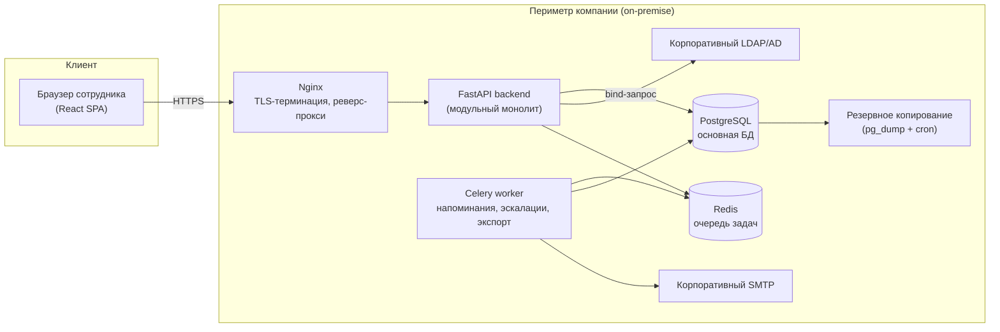
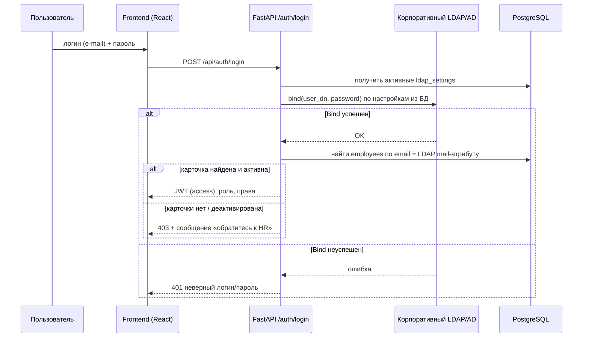

# План реализации (plan.md) — Система учёта отпусков

**Версия документа:** 1.15
**Дата:** 19.10.2026
**Основание:** `docs/requirements.md`, версия 1.20 (включая закрытое решение T-000 по шифрованию чувствительных данных, отказ от файлов-вложений к заявкам, FR-AUTH-005 — bootstrap-учётная запись администратора, уточнения FR-AUTH-002/004 по итогам ревью PR #134, и разведение маршрута/права согласования и вершины иерархии в FR-EMP-001/FR-APPR-001 по итогам планирования `T-M1-10`/`T-M1-15`); в v1.6 добавлены решения по импорту сотрудников (`FR-EMP-003`, §6) по итогам планирования `T-M1-11`; в v1.7 по итогам ревью PR #139 сужено решение о несохранении файла импорта — приложение само не пишет его на диск/в БД, но Starlette временно выгружает часть запроса больше 1 МиБ во временный файл; в v1.8 по итогам ревью PR #140 (T-M1-38) зафиксирован контракт поля `employees.full_name` — на него теперь явно опирается и парольная политика (FR-AUTH-002), и импорт сотрудников (§6); в v1.9 решением владельца продукта перед проектированием фронтенда M1 добавлены правило самообслуживания по `accounts.employee_id` вместо `role` (следствие `requirements.md` v1.12, §13 п. 22, §5.1) и решение о хранении обеих JWT-сессий во фронтенде в `localStorage` на MVP (§5.2); в v1.10 исправлена собственная строка «Основание» — называла `requirements.md` версии 1.9, тогда как фактическая версия к этому моменту была 1.12; в v1.11 по итогам реализации `T-M1-45` в таблицу «эндпоинт → роли» §5.1 добавлен `GET /api/auth/password-policy`; в v1.12 по итогам планирования `T-M1-18` сужено решение о хранении токенов (§5.2) — на MVP хранится только `access`, не `refresh`, у которого нет принимающего эндпоинта (`T-M1-35`); в v1.13 решением владельца продукта при закрытии `T-M1-35` (`requirements.md` v1.17, `FR-AUTH-001/3`) выдача `refresh`-токена прекращена вовсе — переписано §5.2 (хранить вопрос более не стоит, а не «хранить только access»), диаграмма §5.2 приведена к действительности, продление сессии с отзывом адресовано именованной задачей `T-M2-17`; попутно исправлена собственная строка «Основание» — называла `requirements.md` версии 1.12, тогда как фактическая версия после этой же ветки стала 1.17; в v1.14 исправлена ссылка §5.2 на закрывающую задачу — `T-M2-17` не существует в M2 (остатки и справочники, не токены), инфраструктура хранения/аудита, на которую решение ошибочно ссылалось, появляется в M6; задача заведена как `T-M1-56`, сознательно отложенная в M1 (`requirements.md` v1.18, раздел 13, п. 27); собственная строка «Основание» снова приведена в соответствие — называла `requirements.md` версии 1.17; в v1.15 при постановке `T-M2-01` в `leave_types` (§4) добавлен признак активности `is_active` — без него нельзя выразить требование A-3.1 и `T-M2-04` («дополнительный оплачиваемый отпуск» есть в справочнике, но выключен по умолчанию), а набор значений `carry_over_policy` зафиксирован как `none`/`unlimited` (решение владельца продукта; случай «не более N дней» потребует отдельной колонки); `unit = hours` в плане уже был, требования приведены к нему в `requirements.md` v1.20; собственная строка «Основание» приведена в соответствие — называла `requirements.md` версии 1.18 при фактической 1.19, а после v1.20 — 1.20
**Статус:** Технический план для декомпозиции на задачи (`tasks.md`) и передачи в разработку AI-агентам (Spec-Driven Development)

**Назначение документа:** описать архитектуру, технологический стек, модель данных, API и порядок реализации MVP системы учёта отпусков. Каждый раздел явно ссылается на функциональные требования (`FR-XXX`) и допущения (`A-N`) из `requirements.md`, чтобы разработчик/AI-агент мог проверить полноту покрытия. Технические решения ниже — конкретизация требований, а не пересмотр их содержания.

---

## 1. Технологический стек

Выбор зафиксирован с заказчиком и подходит под ограничения раздела 4 требований (on-premise, LDAP, до 500 пользователей).

| Слой | Технология | Обоснование |
|---|---|---|
| Backend | **Python 3.12 + FastAPI** | Асинхронный REST API, автогенерация OpenAPI-схемы (полезно для AI-агентов и фронтенда), зрелая экосистема для LDAP (`ldap3`), фоновых задач и работы с Excel/CSV. |
| ORM / миграции | **SQLAlchemy 2.x + Alembic** | Явная типизация моделей, управляемые миграции — критично при частых изменениях справочников (раздел 6, 5 требований). |
| База данных | **PostgreSQL 16** | Надёжность, поддержка `JSONB` (для audit log — было/стало), оконных функций (отчёты), полнотекстового поиска; стандарт для on-premise российских компаний. |
| Фоновые задачи / очередь | **Celery + Redis** (либо APScheduler на старте, см. раздел 9) | Напоминания (`FR-NOTIF-002`), эскалации (`FR-APPR-004`), уведомления о начале отпуска (`FR-SCHED-004`) требуют планировщика, независимого от HTTP-запросов. |
| Аутентификация | **ldap3** (LDAP/AD bind) + JWT-сессии на стороне API (**PyJWT**, HS256) | Соответствует `FR-AUTH-001`, `FR-ADMIN-005`. PyJWT, а не `python-jose`: последний практически не сопровождается и содержит CVE-2024-33663 (algorithm confusion) и CVE-2024-33664 (DoS). |
| Frontend | **React 18 + TypeScript**, Vite, React Query, React Router | SPA с богатой экосистемой компонентов (таблицы, календарь, формы) — соответствует `NFR-USAB-001`. |
| UI-компоненты | **Ant Design** (рекомендация; допустима замена на MUI на этапе техдизайна) | Готовые таблицы, деревья (оргструктура), календари, формы с валидацией — ускоряет разработку HR-интерфейсов. |
| Почтовые уведомления | SMTP (корпоративный сервер компании) через `aiosmtplib`/Celery-задачу | `FR-NOTIF-001` |
| Контейнеризация | **Docker + Docker Compose** | Для on-premise-развёртывания на собственных серверах компании (см. раздел 8). |
| Реверс-прокси / TLS | **Nginx** | Терминация TLS (`NFR-SEC-001`), раздача статики фронтенда, проксирование API. |
| Тестирование backend | **pytest + pytest-asyncio + httpx** | Юнит- и интеграционные тесты, тестовый клиент FastAPI. |
| Тестирование frontend | **Vitest + React Testing Library**, **Playwright** (e2e) | Проверка ключевых пользовательских сценариев (подача заявки, согласование). |

> Архитектурный стиль MVP — **модульный монолит** (не микросервисы): при штате до 500 человек и нагрузке из `NFR-PERF-001` (до 150 одновременных пользователей) микросервисная декомпозиция избыточна и увеличивает эксплуатационные риски on-premise-развёртывания. Модульность обеспечивается на уровне пакетов кода (раздел 4), что не мешает выделению сервисов в будущем при необходимости.

---

## 2. Высокоуровневая архитектура



Ключевые архитектурные решения:

- **Вся инфраструктура — в периметре компании** (соответствует A-1, A-4, требованию хранения персональных данных на территории РФ, `NFR-COMPLY-001`). Внешних облачных зависимостей в MVP нет.
- **LDAP — единственная внешняя интеграция** (`FR-AUTH-001`): backend выполняет bind-запрос к корпоративному каталогу; сама Система не хранит пароли пользователей LDAP.
- **Worker отделён от API-процесса**, чтобы длительные операции (импорт сотрудников, формирование отчётов, рассылка напоминаний) не блокировали отклик API (`NFR-PERF-001`).
- **База данных — единая точка правды**; журнал аудита (`FR-AUDIT-001`) реализуется как отдельная неизменяемая таблица с ограничением прав на `UPDATE`/`DELETE` на уровне БД (см. раздел 9.4).

---

## 3. Структура репозитория

```
vacation-tracker/
├── backend/
│   ├── app/
│   │   ├── main.py                 # точка входа FastAPI
│   │   ├── core/                   # конфигурация, security, LDAP-клиент, settings
│   │   ├── db/                     # SQLAlchemy engine, base, session
│   │   ├── models/                 # ORM-модели (раздел 6)
│   │   ├── schemas/                # Pydantic-схемы запросов/ответов
│   │   ├── modules/
│   │   │   ├── employees/          # FR-EMP
│   │   │   ├── balances/           # FR-BAL
│   │   │   ├── schedule/           # FR-SCHED
│   │   │   ├── requests/           # FR-REQ (общая логика заявок)
│   │   │   ├── sick_leave/         # FR-SICK
│   │   │   ├── day_off/            # FR-DAYOFF
│   │   │   ├── approvals/          # FR-APPR
│   │   │   ├── notifications/      # FR-NOTIF
│   │   │   ├── calendar/           # FR-CAL
│   │   │   ├── reports/            # FR-REPORT
│   │   │   ├── admin/              # FR-ADMIN (включая LDAP-настройки)
│   │   │   ├── auth/               # FR-AUTH
│   │   │   └── audit/              # FR-AUDIT
│   │   └── workers/                # Celery-задачи (напоминания, эскалации)
│   ├── alembic/                    # миграции БД
│   ├── tests/                      # unit + integration, по одному пакету на модуль
│   └── pyproject.toml
├── frontend/
│   ├── src/
│   │   ├── pages/                  # Мой отпуск, Календарь команды, Заявки, Админка...
│   │   ├── components/
│   │   ├── entities/                # employee, leaveRequest, leaveType, ...
│   │   ├── api/                    # сгенерированный клиент из OpenAPI-схемы backend
│   │   └── app/                    # роутинг, провайдеры, RBAC-guard
│   └── package.json
├── infra/
│   ├── docker-compose.yml
│   ├── docker-compose.prod.yml
│   ├── nginx/
│   └── backup/                     # скрипты pg_dump + расписание cron
└── docs/
    ├── requirements.md             # уже подготовлен (v1.2)
    ├── plan.md                     # этот документ
    └── tasks.md                    # следующий шаг SDD-процесса
```

---

## 4. Модель данных (схема PostgreSQL)

Конкретизация ER-диаграммы раздела 10 требований. Типы приведены ориентировочно — уточняются при написании миграций.

| Таблица | Ключевые поля | Комментарий / связь с требованиями |
|---|---|---|
| `departments` | `id`, `name`, `parent_id → departments.id`, `head_employee_id → employees.id` | Дерево подразделений, `FR-EMP-002`. |
| `employees` | `id`, `full_name` (одна строка «Фамилия Имя Отчество», части выделяются разбиением по пробельным символам — `str.split()`; отдельных полей на фамилию/имя/отчество нет), `personnel_number` (unique), `department_id`, `position`, `hire_date`, `manager_id → employees.id`, `email` (unique — уникальность обеспечивается индексом по `lower(email)`, поиск сотрудника по e-mail регистронезависим), `work_schedule_type` (`standard`/`shift`), `employment_status` (`active`/`terminated`), `termination_date`, `leave_category` (nullable, зарезервировано под A-3.1), `created_at`, `updated_at` | `FR-EMP-001`, `FR-EMP-004`. `work_schedule_type` — признак сменного графика, A-7. Контракт `full_name` (одна строка, части — по пробелу) — не только описание поля: на нём построена проверка ФИО в парольной политике (`FR-AUTH-002`, `password_policy._full_name_tokens`/`_full_name_short_tokens`) и колонка ФИО при импорте (§6); решение принято по итогам ревью PR #140, T-M1-38. |
| `accounts` | `id`, `employee_id → employees.id` (nullable для служебных записей), `login` (nullable, unique — логин для записей без карточки сотрудника, например bootstrap-администратора, `FR-AUTH-005`; для записей с `employee_id` не заполняется, логином служит `employees.email`; `CHECK` гарантирует ровно одно заполненное поле из `employee_id`/`login`), `auth_type` (`ldap`/`local`), `local_password_hash` (nullable), `must_change_password` (bool), `failed_login_attempts`, `locked_until` (nullable), `role` (`employee`/`hr_admin`/`accountant`/`system_admin`), `is_active` | `FR-AUTH-001…005`. Роль «руководитель» — не отдельная запись `role`, а производится из наличия подчинённых (`employees.manager_id`), см. раздел 5. |
| `ldap_settings` | `id`, `server_url`, `port`, `base_dn`, `bind_dn`, `bind_password_encrypted`, `user_match_attribute` (по умолчанию `mail`), `is_active`, `last_tested_at`, `last_test_status` | `FR-ADMIN-005`, A-8. `bind_password_encrypted` — обратимое шифрование на уровне приложения (`cryptography`, AES-GCM либо Fernet), ключ из `LDAP_PASSWORD_ENCRYPTION_KEY` (см. §5.2, `NFR-SEC-001` в §9, T-000). |
| `leave_types` | `id`, `code` (unique), `name`, `is_paid` (`full`/`none`/`partial`), `unit` (`calendar_days`/`working_days`/`hours`), `reduces_main_balance` (bool), `requires_document` (bool), `requires_approval` (bool), `annual_limit` (nullable), `carry_over_policy` (`none`/`unlimited` — решение владельца продукта; поведение переноса пока не определено ни одним `FR`, значение хранится, но не читается; случай «не более N дней» потребует отдельной колонки), `exclude_weekends_holidays` (bool), `is_active` (bool, по образцу `ldap_settings.is_active`; влияние на подачу заявок этим пунктом не определяется — решается при реализации `FR-REQ-*`) | Раздел 6, `FR-ADMIN-001`, A-3.1. |
| `leave_balances` | `id`, `employee_id`, `leave_type_id`, `working_year_start`, `working_year_end`, `accrued`, `used`, `manual_adjustment`, `adjustment_reason` | `FR-BAL-001…004`. Остаток = `accrued + manual_adjustment - used` (вычисляется, не хранится как отдельное поле, либо материализуется представлением). |
| `overtime_ledger` | `id`, `employee_id`, `hours_accrued`, `hours_used`, `source` (`weekend_work`/`shift_overtime`/…), `related_request_id`, `note`, `created_at` | Счётчик компенсации за переработку/сменную работу, `FR-DAYOFF-001`, A-7 (почасовая оплата). |
| `leave_requests` | `id`, `employee_id`, `leave_type_id`, `start_date`, `end_date`, `quantity` (дни либо часы — по `leave_types.unit`), `status` (`draft`/`pending`/`approved`/`rejected`/`cancelled`/`superseded`), `basis` (основание для отгула/командировки), `document_number` (напр. номер ЭЛН, nullable), `document_date_from` (nullable), `document_date_to` (nullable), `related_request_id` (self-FK, перенос/продление), `created_by_account_id`, `created_at`, `updated_at` | `FR-REQ-001…005`, `FR-SICK-001…003`, `FR-DAYOFF-001…002`. `document_*` — реквизиты подтверждающего документа (T-000); файл не хранится. |
| `approval_routes` | `id`, `leave_type_id` (nullable = маршрут по умолчанию), `department_id` (nullable), `steps_config` (JSONB: порядок ролей/этапов) | Настраиваемость маршрута, `FR-APPR-001`. |
| `approval_steps` | `id`, `leave_request_id`, `step_order`, `approver_employee_id`, `status` (`pending`/`approved`/`rejected`/`delegated`), `acted_at`, `comment` | `FR-APPR-001…005`. |
| `approval_delegations` | `id`, `delegator_employee_id`, `delegate_employee_id`, `date_from`, `date_to` | `FR-APPR-003`. |
| `vacation_schedules` | `id`, `year` (unique), `status` (`draft`/`approved`), `approved_by_account_id`, `approved_at` | `FR-SCHED-003`. Явно **без** полей ЭП/УКЭП — утверждение фиксируется как обычная запись + аудит. |
| `schedule_entries` | `id`, `schedule_id`, `employee_id`, `planned_start_date`, `planned_end_date`, `days` | `FR-SCHED-001…002`. |
| `production_calendar_days` | `id`, `date` (unique), `day_type` (`working`/`weekend`/`holiday`) | `FR-CAL-002`, `FR-ADMIN-003`. |
| `notifications` | `id`, `recipient_employee_id`, `type`, `payload` (JSONB), `status` (`queued`/`sent`/`failed`), `sent_at` | `FR-NOTIF-001…003`. |
| `audit_log` | `id`, `actor_account_id`, `entity_type`, `entity_id`, `action`, `old_value` (JSONB), `new_value` (JSONB), `created_at` | `FR-AUDIT-001`. Только `INSERT`; права `UPDATE`/`DELETE` отсутствуют даже у роли приложения на уровне БД (см. `NFR-AUDIT-001`). |
| `business_rules_config` | `key` (unique), `value`, `description`, `updated_by_account_id`, `updated_at` | Параметры раздела 5 (28 дней, 2 недели, 14 дней, срок эскалации и т.д.), `FR-ADMIN-004`. Хранение в виде key-value упрощает добавление новых параметров без миграций. |

Колоночное шифрование к данным о больничных (`leave_requests` при `leave_type = больничный`) не применяется (решение T-000, `NFR-SEC-001`): защищаемый факт выражен структурой строки (сотрудник, вид отсутствия, даты), а не значением поля, поэтому шифрование колонки его не скрывает. Защита обеспечивается шифрованием носителя БД и резервных копий, ролевой моделью доступа (`NFR-SEC-002`) и тем, что диагноз/причина нетрудоспособности и файлы документов Система не хранит вовсе. Обратимое шифрование на уровне приложения применяется только к `ldap_settings.bind_password_encrypted` (см. выше).

---

## 5. Роли, аутентификация и авторизация

### 5.1 Модель ролей в коде

- `role` в `accounts` определяет **системную роль** (RBAC, раздел 7 требований): `employee`, `hr_admin` (объединяет HR-специалиста и HRD, `A-4`/`FR-SCHED-003`), `accountant`, `system_admin`.
- Роль **«руководитель»** — не хранится как значение `role`, а вычисляется динамически: сотрудник является руководителем для всех, у кого `employees.manager_id = его id`. Права руководителя (согласование, просмотр календаря команды) проверяются через этот признак, а не через отдельную роль — так один и тот же человек автоматически получает права руководителя при назначении подчинённых, без ручного переключения ролей (соответствует примечанию раздела 3 требований).

Раздел 7 требований прямо делегирует детальную матрицу прав (CRUD по сущностям) техническому проекту — ниже конкретизация для `departments`/`employees` (`T-M1-10/14/15`).

**Матрица «эндпоинт → роли» для оргструктуры и карточек сотрудников:**

| Действие | Роли |
|---|---|
| Ведение подразделений (`POST`/`PUT /api/departments*`) | `hr_admin`, `system_admin` |
| Создание и редактирование карточек (`POST`/`PUT /api/employees*`) | `hr_admin`, `system_admin` |
| Просмотр своей карточки (`GET /api/employees/{id}`, где `id` — своя) | любой аутентифицированный |
| Просмотр чужой карточки | руководитель — своя команда (см. ниже); `hr_admin`, `system_admin` — все; `accountant` — все, только чтение |
| Состав действующих правил парольной политики (`GET /api/auth/password-policy`, `T-M1-45`) | любая авторизованная учётная запись — не публичный эндпоинт, но и не привязан к конкретной роли |

**Два разных понятия — не смешивать в коде:**
- **«Непосредственный руководитель»** — `employees.manager_id`. Определяет МАРШРУТ согласования (`FR-APPR-001`): куда заявка направляется по умолчанию.
- **«Своя команда»** — всё поддерево подчинения (прямые и косвенные подчинённые, вычисляется рекурсивным обходом `manager_id`). Определяет ПРАВО просматривать карточки сотрудников и, начиная с M3, право закрыть шаг согласования «руководитель» (наследуется вверх по цепочке, `FR-APPR-001` в редакции v1.7).

Это две разные функции с разными именами в коде (`is_direct_manager_of` и функции проверки/выборки по цепочке подчинения, `T-M1-10`) — первая не является частным случаем второй: маршрут всегда указывает на прямого руководителя, а право просмотра/согласования — на весь путь вверх по иерархии.

**Учётная запись при создании карточки (`FR-EMP-001` в редакции v1.7):** создание карточки сотрудника в одной транзакции создаёт связанную запись `accounts` (`accounts.employee_id`) с ролью по умолчанию `employee`; последующее изменение роли — прерогатива `system_admin`. Ограничение `num_nonnulls(employee_id, login) = 1` (`T-M1-03`) означает, что у записи, привязанной к карточке, поле `login` не заполняется — входом служит `employees.email`, а `accounts.login` остаётся зарезервированным для служебных записей без карточки (например, bootstrap-администратора, `FR-AUTH-005`).

**Принятое следствие объединения ролей HR-специалиста и HRD в `hr_admin`:** финальное согласование заявки (`FR-APPR-001`) вправе выполнить любой пользователь с ролью `hr_admin`, а не только фактический HRD — в MVP это осознанно принято вместе с самим объединением ролей (см. `requirements.md` §13, п. 4).

**Правило самообслуживания (`requirements.md` §7, «Правило самообслуживания»; §13, п. 22):** доступ к СВОИМ данным — заявки, остаток и история, плановые даты в графике — проверяется по `accounts.employee_id`, а не по `role`. Строка «Просмотр своей карточки» в таблице выше уже следует этому принципу (`account.employee_id == target_employee_id`, независимо от роли — см. `can_view_employee`, `T-M1-15`); M2/M3 применяют ТОТ ЖЕ приём к своим таблицам, а не изобретают отдельную проверку роли на каждый эндпоинт:
- `leave_balances`/история начислений (`FR-BAL-002`, M2): `WHERE employee_id = account.employee_id`, без условия по `role`.
- Заявки на отсутствие (`FR-REQ-*`, M3): автор заявки — `account.employee_id`, а не текущая роль; список «Мои заявки» фильтруется тем же полем.
- Плановые даты графика (`FR-SCHED-002`, M4): запись плановых дат привязана к `employee_id`, доступна владельцу независимо от `role`.

Учётная запись без карточки (`employee_id IS NULL`, служебные/административные записи, `FR-AUTH-005`) не проходит ни одну из этих проверок — самообслуживания у неё нет, что ожидаемо: отпуска без карточки сотрудника не существует.

### 5.2 Поток аутентификации (`FR-AUTH-001`, `FR-ADMIN-005`)



- Параметры подключения (`server_url`, `port`, `base_dn`, `bind_dn`, пароль сервисной записи, атрибут сопоставления) читаются из таблицы `ldap_settings`, редактируются только через `system_admin`-интерфейс (`FR-ADMIN-005`), включают кнопку «тестовое подключение» (отдельный эндпоинт `POST /api/admin/ldap-settings/test`, не сохраняющий некорректные параметры).
- Локальная аутентификация (`FR-AUTH-002`) — для записей с `auth_type = local`: служебных/административных (в первую очередь `system_admin` на случай недоступности LDAP-сервера) и отдельных сотрудников, которым такой способ входа назначен в карточке (`FR-EMP-001`). Пароль хранится как `bcrypt`-хэш (`NFR-SEC-004`); флаг `must_change_password` форсирует смену первичного пароля, счётчик `failed_login_attempts` вместе с `locked_until` реализуют временную блокировку после серии неудачных попыток.
- Режим внедрения (`FR-AUTH-003`): пока в `ldap_settings` нет активной записи, `/api/auth/login` обслуживает всех пользователей локально, а UI показывает администратору предупреждение. После успешного сохранения и проверки параметров каталога способ входа по умолчанию переключается на LDAP; сотрудники с явно выбранным локальным паролем продолжают входить локально.
- Общие проверки доступа (`FR-AUTH-004`) вынесены в отдельный сервис, вызываемый после любой успешной аутентификации: наличие и активность карточки сотрудника, активность учётной записи, назначение роли — одинаково для LDAP и локального входа.
- Авторизация — через FastAPI-зависимость (`dependency`), проверяющую JWT и роль/принадлежность к подразделению перед каждым эндпоинтом; матрица соответствует разделу 7 требований.
- **Хранение токенов во фронтенде (решение владельца продукта, `T-M1-35`, `FR-AUTH-001/3`):** `TokenResponse` содержит только `access`-токен — `refresh`-токен система не выдаёт вовсе, так что хранить вопрос не стоит: credential, который некому предъявить (эндпоинта обновления нет и не планировалось) и нечем отозвать (хранилища выданных токенов нет), — риск без пользы, а не функциональность, которую можно было бы урезать до «не сохранять». До `T-M1-35` это звучало как узкое решение «хранить только access, не refresh»; после — констатация, что второго токена в контракте API больше нет. Фронтенд хранит `access`-токен в `localStorage`. Компромисс называется прямо, а не замалчивается: `localStorage` переживает перезагрузку страницы и прост в реализации, но при XSS `access`-токен угоняется целиком на весь срок его действия (60 минут, `settings.jwt_access_token_ttl_minutes`). Рассмотренная и отклонённая альтернатива — `httpOnly` + `SameSite` cookie с CSRF-защитой: единственный вариант, реально ограничивающий ущерб от XSS (JS не может прочитать `httpOnly`-cookie), но требует правки backend (токен отдаётся в теле `TokenResponse`, а не выставляется как cookie) и отдельной CSRF-защиты; вынесено за пределы MVP. Условие пересмотра то же: возврат к этому решению обязателен до того, как в интерфейсе появится рендеринг непроверенного пользовательского HTML/Markdown — на MVP таких мест в разделах, согласованных с `ui.md`, нет. При истечении `access`-токена сессия просто заканчивается — сервер отвечает 401, фронтенд очищает хранилище и показывает экран входа, без попытки продления; полноценное продление сессии (эндпоинт обновления, хранилище выданных токенов с отзывом, ротация) — отдельная задача `T-M1-56`, сознательно отложенная в M1 (решение владельца продукта), и именно при её реализации вопрос хранения на фронтенде (включая пересмотр `httpOnly`-альтернативы) открывается заново.
- Bootstrap-учётная запись администратора (`FR-AUTH-005`): при старте приложения сервис проверяет, есть ли в `accounts` активная запись с `role = system_admin`; если нет — создаёт локальную (`auth_type = local`, `employee_id = NULL`) с логином/паролем из `BOOTSTRAP_ADMIN_LOGIN`/`BOOTSTRAP_ADMIN_PASSWORD`, `must_change_password = true`, и пишет факт создания в лог приложения. Проверка идемпотентна и выполняется при каждом старте, поэтому не создаёт дублей после того, как появилась хотя бы одна активная запись `system_admin` (в том числе позже сопоставленная с карточкой сотрудника через LDAP).

---

## 6. Модули backend и покрытие требований

| Модуль (пакет) | Функциональные требования | Основные сущности |
|---|---|---|
| `auth` | FR-AUTH-001…005 | `accounts`, `ldap_settings` |
| `employees` | FR-EMP-001…004 | `employees`, `departments` |
| `balances` | FR-BAL-001…004 | `leave_balances` |
| `schedule` | FR-SCHED-001…004 | `vacation_schedules`, `schedule_entries` |
| `requests` | FR-REQ-001…005 | `leave_requests` |
| `sick_leave` | FR-SICK-001…003 | `leave_requests` (тип = больничный) |
| `day_off` | FR-DAYOFF-001…002 | `leave_requests`, `overtime_ledger` |
| `approvals` | FR-APPR-001…005 | `approval_routes`, `approval_steps`, `approval_delegations` |
| `notifications` | FR-NOTIF-001…003 | `notifications` (+ Celery-задачи) |
| `calendar` | FR-CAL-001…002 | `leave_requests` (агрегированные выборки), `production_calendar_days` |
| `reports` | FR-REPORT-001…004 | Только чтение, агрегирующие запросы по нескольким таблицам |
| `admin` | FR-ADMIN-001…005 | `leave_types`, `departments`, `production_calendar_days`, `business_rules_config`, `ldap_settings` |
| `audit` | FR-AUDIT-001 | `audit_log` (запись — через общий middleware/декоратор на изменяющих операциях всех модулей) |

`sick_leave` и `day_off` **не дублируют** логику `requests` — это тонкие модули, добавляющие специфичную валидацию (номер ЭЛН; основание и единица учёта отгула) поверх общего движка заявок `requests`, что прямо требует раздел 12 требований («без хардкода логики под конкретный вид»).

**Решения по импорту сотрудников (`FR-EMP-003`, `T-M1-11`).** Переиспользуются M8 (импорт реальных данных при развёртывании), поэтому зафиксированы здесь, а не только в теле коммита реализации:

1. Импорт СОЗДАЁТ, но не обновляет. Назначение по `FR-EMP-003` — начальная загрузка при запуске Системы; молчаливая перезапись кадровых данных повторной загрузкой файла опаснее, чем отказ. Строка с уже существующим `personnel_number` или e-mail — ошибка строки, а не обновление.
2. Руководитель в файле указывается по `personnel_number`, а не по e-mail или id: он стабилен и не меняется при смене фамилии. Связи разрешаются ПОСЛЕ чтения всего файла — руководитель может стоять ниже подчинённого.
3. Подразделение указывается по имени и должно существовать заранее; импорт подразделений не создаёт. Неоднозначное имя (одно и то же в разных ветках дерева, `departments.name` не уникально) — ошибка строки с указанием конфликта.
4. Способ входа для всех импортируемых — LDAP. Колонка с первичным паролем не предусмотрена сознательно: она означала бы открытые пароли в файле, который HR пересылает почтой. Локальный вход назначается индивидуально через карточку (`T-M1-15`).
5. Приложение само не пишет загруженный файл ни на диск, ни в БД (то же решение T-000, что и об отказе от хранения вложений к заявкам) — из кода приложения это не проверить и не изменить: разбор файла (`import_parsing.py`) работает с байтами в памяти, минуя файловую систему. Но Starlette (PR #139 review, замечание 1 оси стандартов) выгружает часть multipart-запроса больше 1 МиБ во временный файл ДО того, как код приложения вообще получает управление (`starlette.formparsers.MultiPartParser`, `tempfile.SpooledTemporaryFile(max_size=1 МиБ)`) — удаляется по завершении запроса, но персональные данные из файла импорта транзитом проходят через файловую систему сервера. Значимо для `NFR-COMPLY-001`: тому, кто будет готовить документы по 152-ФЗ, нужно знать об этом транзитном хранении, даже если оно временное и вне контроля кода приложения.

---

## 7. Основные API-эндпоинты (сокращённо)

Полная OpenAPI-схема генерируется автоматически из FastAPI-кода; ниже — состав для планирования `tasks.md`.

```
POST   /api/auth/login                          FR-AUTH-001
POST   /api/auth/login/local                     FR-AUTH-002
POST   /api/auth/password/change                 FR-AUTH-002
POST   /api/auth/password/reset-request          FR-AUTH-002
POST   /api/auth/logout
GET    /api/auth/me

GET    /api/departments
POST   /api/departments                          FR-EMP-002
GET    /api/employees
POST   /api/employees                            FR-EMP-001
GET    /api/employees/{id}
PUT    /api/employees/{id}
POST   /api/employees/import                      FR-EMP-003
POST   /api/employees/{id}/deactivate            FR-EMP-004

GET    /api/employees/{id}/balances               FR-BAL-002
POST   /api/employees/{id}/balances/adjust        FR-BAL-004

GET    /api/leave-types
POST   /api/leave-types                           FR-ADMIN-001

POST   /api/leave-requests                        FR-REQ-001, FR-SICK-001, FR-DAYOFF-001, FR-DAYOFF-002
GET    /api/leave-requests
GET    /api/leave-requests/{id}
POST   /api/leave-requests/{id}/cancel            FR-REQ-003
POST   /api/leave-requests/{id}/transfer           FR-REQ-004

POST   /api/leave-requests/{id}/approve            FR-APPR-001
POST   /api/leave-requests/{id}/reject             FR-APPR-001
POST   /api/approval-delegations                   FR-APPR-003

GET    /api/vacation-schedules/{year}
POST   /api/vacation-schedules/{year}/entries       FR-SCHED-002
POST   /api/vacation-schedules/{year}/approve       FR-SCHED-003
GET    /api/vacation-schedules/{year}/export        FR-REPORT-003

GET    /api/calendar                                FR-CAL-001

GET    /api/reports/balances                        FR-REPORT-001
GET    /api/reports/absences                         FR-REPORT-002
GET    /api/reports/violations                       FR-REPORT-004

GET/PUT /api/admin/production-calendar/{year}        FR-ADMIN-003
GET/PUT /api/admin/business-rules                    FR-ADMIN-004
GET/PUT /api/admin/ldap-settings                     FR-ADMIN-005
POST   /api/admin/ldap-settings/test

GET    /api/audit-log                                FR-AUDIT-001
```

---

## 8. Развёртывание (on-premise)

- **Docker Compose** на серверах компании: контейнеры `nginx`, `backend` (FastAPI + Uvicorn/Gunicorn), `worker` (Celery), `redis`, `postgres`. Frontend собирается статически (Vite build) и раздаётся через `nginx`.
- Минимальные требования к серверу для 500 сотрудников (ориентир, уточняется при нагрузочном тестировании под `NFR-PERF-001`): 4 vCPU / 8 GB RAM для связки backend+worker, отдельный диск/сервер под PostgreSQL с SSD.
- **TLS** — сертификат компании (внутренний CA или публичный, по решению ИТ), терминация на `nginx` (`NFR-SEC-001`).
- **Резервное копирование** (`NFR-BACKUP-001`) — ежедневный `pg_dump` по cron с ротацией 30 дней; хранение бэкапов вне сервера БД (второй диск/файловое хранилище компании).
- **Часовой пояс контейнеров** — `Europe/Moscow` (`NFR-LOC-001`).
- CI/CD и способ доставки обновлений на серверы компании (GitLab CI/Jenkins/ручной деплой) — уточняется на этапе `tasks.md` совместно с ИТ-отделом заказчика (вне текущей спецификации).

---

## 9. Нефункциональные требования → технические решения

| NFR | Техническое решение |
|---|---|
| NFR-PERF-001 | Асинхронный FastAPI + пул соединений PostgreSQL (SQLAlchemy async engine); индексы на `leave_requests(employee_id, status)`, `leave_balances(employee_id, leave_type_id)`; нагрузочное тестирование (Locust) перед запуском. |
| NFR-AVAIL-001 | Health-check эндпоинт (`/healthz`), автоперезапуск контейнеров (`restart: unless-stopped` / systemd), мониторинг доступности (см. раздел 10). |
| NFR-SEC-001/002 | TLS на `nginx`; шифрование носителя БД и резервных копий (без колоночного шифрования — решение T-000); доступ к сведениям о больничных ограничен ролевой моделью приложения; диагноз/причина нетрудоспособности в схеме отсутствует в принципе (поле не создаётся). Обратимое шифрование на уровне приложения (`cryptography`) — отдельно, только для `ldap_settings.bind_password_encrypted` (ключ `LDAP_PASSWORD_ENCRYPTION_KEY`). |
| NFR-SEC-003 | RBAC-зависимость FastAPI на каждом эндпоинте + фильтрация выборок по `department_id`/`manager_id` для роли «руководитель». |
| NFR-COMPLY-001 | Вся инфраструктура — на серверах компании в РФ (раздел 8); политика хранения — раздел NFR-DATA-001. |
| NFR-DATA-001 | Мягкое удаление (`employment_status = terminated`), данные не физически удаляются; настраиваемый срок хранения в `business_rules_config`. |
| NFR-USAB-001 | Адаптивная вёрстка на Ant Design (брейкпоинты), проверка на мобильных разрешениях в Playwright. |
| NFR-SCALE-001 | Горизонтальное масштабирование `backend`/`worker` контейнеров за `nginx` (stateless backend, состояние — только в PostgreSQL/Redis). |
| NFR-MAINT-001 | Справочники и бизнес-правила — данные в БД (`leave_types`, `business_rules_config`), редактируемые через `admin`-модуль, без релиза кода. |
| NFR-AUDIT-001 | На уровне БД у роли приложения нет прав `UPDATE`/`DELETE` на `audit_log` (`REVOKE`); запись — только через `INSERT`, инициируемый backend-кодом. |
| NFR-BACKUP-001 | См. раздел 8. |

---

## 10. Наблюдаемость и эксплуатация

- Структурированное логирование (JSON) в `backend`/`worker`, ротация логов на уровне Docker/ОС.
- Health-check эндпоинты для `backend` (`/healthz`, проверка соединения с БД и LDAP) — основа для мониторинга силами ИТ-отдела компании (Zabbix/Prometheus — по выбору заказчика, вне текущей спецификации).
- Метрики очереди Celery (длина очереди, число неуспешных задач) — для контроля своевременности напоминаний (`FR-NOTIF-002`).

---

## 11. Стратегия тестирования

| Уровень | Инструмент | Покрытие |
|---|---|---|
| Unit (backend) | pytest | Бизнес-логика расчёта остатков (`FR-BAL-001`), правил разделения отпуска (`FR-REQ-002`), маршрутов согласования (`FR-APPR-*`). |
| Integration (backend) | pytest + httpx + тестовая БД | API-эндпоинты по каждому модулю раздела 6, включая проверку критериев приёмки EARS из требований (каждый `WHEN/IF` — отдельный тест-кейс). |
| Unit (frontend) | Vitest + RTL | Компоненты форм заявок, отображение остатков. |
| E2E | Playwright | Ключевые сквозные сценарии: подача заявки → согласование руководителем → согласование HR; формирование и утверждение графика отпусков; вход через LDAP (на тестовом LDAP-сервере, например OpenLDAP в docker-compose для CI). |
| Нагрузочное | Locust | Проверка `NFR-PERF-001` перед приёмочным тестированием (раздел 12 требований). |

Тестовый LDAP-сервер (OpenLDAP в Docker) включается в `docker-compose.yml` для CI и локальной разработки, чтобы не зависеть от боевого AD компании на этапе разработки.

---

## 12. Этапы реализации (укрупнённо, для дальнейшей декомпозиции в tasks.md)

| Этап | Содержание | Требования |
|---|---|---|
| **M0. Каркас** | Репозиторий, docker-compose (Postgres, Redis, тестовый LDAP), CI-пайплайн тестов, база моделей и миграций. | — |
| **M1. Аутентификация и сотрудники** | `auth`, `employees`, `departments`, `admin` (LDAP-настройки, производственный календарь). | FR-AUTH-*, FR-EMP-*, FR-ADMIN-002/003/005 |
| **M2. Остатки и справочники** | `leave_types`, `balances`, `business_rules_config`, `admin` (виды отсутствий, параметры правил). | FR-BAL-*, FR-ADMIN-001/004 |
| **M3. Заявки и согласование** | `requests` (общий движок), `sick_leave`, `day_off` (включая `overtime_ledger`), `approvals`. | FR-REQ-*, FR-SICK-*, FR-DAYOFF-*, FR-APPR-* |
| **M4. График отпусков** | `schedule`, печатная форма (аналог Т-7). | FR-SCHED-* |
| **M5. Календарь и уведомления** | `calendar`, `notifications`, Celery-задачи напоминаний/эскалаций. | FR-CAL-*, FR-NOTIF-* |
| **M6. Отчётность и аудит** | `reports`, `audit` (включая middleware записи аудита во всех модулях). | FR-REPORT-*, FR-AUDIT-* |
| **M7. Безопасность и эксплуатация** | Шифрование чувствительных полей, резервное копирование, нагрузочное тестирование, финальная проверка NFR. | NFR-SEC-*, NFR-BACKUP-001, NFR-PERF-001 |
| **M8. Импорт данных и приёмка** | Импорт реальных сотрудников/остатков (`FR-EMP-003`), приёмочное тестирование с HRD и руководителями (в т.ч. со сменными сотрудниками). | Раздел 12 требований (DoD) |

Этапы соответствуют зависимостям между модулями (например, `requests` не может быть реализован раньше `employees` и `leave_types`) и образуют основу для декомпозиции на задачи в `tasks.md`.

---

## 13. Расширяемость под Фазу 2 (архитектурные заделы)

В соответствии с A-6 требований, следующие решения заложены заранее, чтобы не переписывать ядро при добавлении интеграций Фазы 2:

- Экспорт отчётов (`reports`) спроектирован через слой «сериализаторов», допускающий добавление нового формата (выгрузка под 1С:ЗУП) без изменения бизнес-логики отчёта.
- `ldap_settings` как отдельная конфигурационная сущность — по той же схеме в будущем может быть добавлена конфигурация SSO/иного провайдера без изменения модели `accounts`.
- `leave_requests`/`leave_balances` не содержат специфичных для 1С полей — при появлении двусторонней интеграции потребуется только новый модуль-адаптер, читающий/пишущий через существующие API `requests`/`balances`.
- Календарные интеграции (Outlook/Google) — точка расширения в модуле `calendar` (дополнительный сериализатор iCal/CalDAV).

---

## 14. Открытые технические вопросы для этапа `tasks.md`

1. ~~Конкретный способ шифрования чувствительных полей~~ — **закрыт (T-000, v1.4/v1.2)**: колоночное шифрование сведений о нетрудоспособности не применяется (защищаемый факт выражен структурой строки, а не значением поля); вместо этого — шифрование носителя БД и резервных копий. Исключение — обратимое шифрование на уровне приложения (`cryptography`, AES-GCM либо Fernet) для пароля служебной записи LDAP, ключ из `LDAP_PASSWORD_ENCRYPTION_KEY`. См. `requirements.md` раздел 13, п. 11, §4/§9 настоящего документа.
2. Способ доставки обновлений на production-серверы компании (CI/CD инструмент, доступ к серверам) — зависит от инфраструктурной политики ИТ-отдела, вне компетенции текущего документа.
3. Точный набор атрибутов LDAP, доступных в корпоративном AD компании (помимо `mail`) — уточняется тестовым подключением на этапе разработки `FR-ADMIN-005`.
4. Библиотека UI-компонентов (Ant Design vs MUI) — окончательный выбор на старте фронтенд-разработки, не блокирует архитектуру.

---

*Документ подготовлен как второй артефакт Spec-Driven Development на основе `requirements.md` v1.2. Следующий шаг — декомпозиция разделов 6, 12 и 13 настоящего плана в `tasks.md` с конкретными задачами, оценками и зависимостями.*
