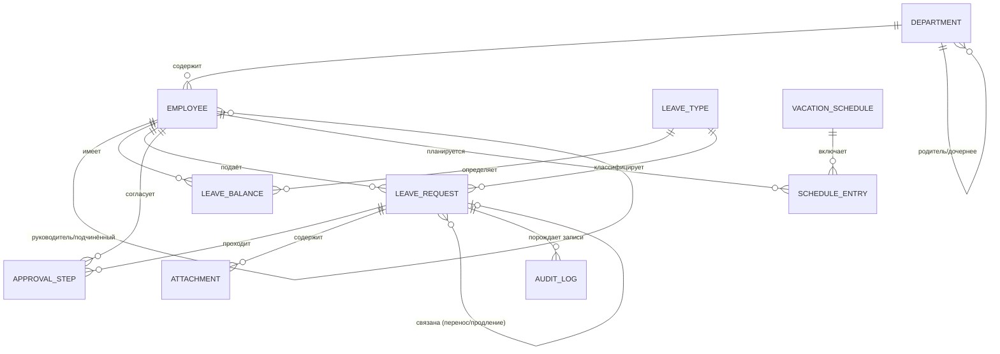

# Требования к системе учёта отпусков

**Проект:** Система учёта отпусков
**Версия документа:** 1.2
**Дата:** 15.09.2026
**Статус:** Черновик для передачи в разработку (Spec-Driven Development); все открытые вопросы раздела 13 (включая остаточные уточнения v1.1) закрыты заказчиком
**Назначение документа:** формальная спецификация для реализации системы силами разработчиков/AI-агентов. Каждое функциональное требование снабжено идентификатором, пользовательской историей и критериями приёмки в нотации EARS (Easy Approach to Requirements Syntax), пригодной для генерации тест-кейсов.

---

## 1. Введение

### 1.1 Назначение системы

Система учёта отпусков (далее — **Система**) автоматизирует процессы планирования, согласования и учёта отсутствий сотрудников компании численностью **до 500 человек**: ежегодных оплачиваемых отпусков, больничных листов, отгулов и командировок. Система заменяет ручной учёт (Excel, бумажные заявления) и обеспечивает соблюдение требований Трудового кодекса РФ (ТК РФ).

### 1.2 Ценность для стейкхолдеров

- **Сотрудник** — видит остаток отпуска, подаёт заявки онлайн, отслеживает статус согласования.
- **Руководитель** — видит календарь отсутствий команды, согласовывает заявки, планирует нагрузку.
- **HR** — формирует и утверждает график отпусков, контролирует соблюдение норм ТК РФ, ведёт справочники.
- **Бухгалтерия** — получает достоверные данные для расчёта отпускных и пособий.
- **Руководство компании** — получает прозрачную отчётность по отсутствиям персонала.

### 1.3 Границы (Scope) — MVP (Фаза 1)

В рамках MVP Система реализуется как **веб-приложение единственного юридического лица** без интеграций учётных систем (1С и т.п.), за единственным исключением, подтверждённым заказчиком как обязательное уже для MVP:

- **аутентификация через LDAP/Active Directory** (см. FR-AUTH-001), с настраиваемыми через интерфейс администратора параметрами подключения к каталогу (см. FR-ADMIN-005) — вместо локальных паролей.

Выгрузка отчётов в формате, совместимом с загрузкой в 1С:ЗУП, **исключена из MVP** и перенесена в Фазу 2 (см. раздел 1.4, раздел 11.2).

Ввод данных о сотрудниках, штатной структуре и начальных остатках отпусков в остальном выполняется вручную/импортом (CSV/XLSX) администратором.

Система покрывает следующие типы отсутствий:
1. Ежегодный оплачиваемый отпуск (основной; удлинённый/дополнительный — предусмотрен в справочнике, но не требуется для запуска, см. A-3.1).
2. Больничные листы (временная нетрудоспособность).
3. Отгулы (в т.ч. за работу в выходной/праздничный день, компенсация по сменному графику) и служебные командировки.
4. Отпуск без сохранения заработной платы (по заявлению).

Система учитывает сотрудников как со стандартным, так и со **сменным графиком работы** (сменные инженеры) — см. A-7 и FR-DAYOFF-001.

### 1.4 Вне области (Out of Scope) — MVP

- Автоматический расчёт заработной платы и отпускных (система передаёт данные, но не считает суммы).
- Прямой электронный обмен с СФР (ЭЛН) — в MVP номер и даты больничного листа вводятся вручную HR/сотрудником.
- Любая интеграция с 1С:ЗУП/1С:Предприятие — как полная (API, двусторонняя), так и односторонняя выгрузка файла в совместимом формате — зафиксирована целиком как **Фаза 2** (см. раздел 14); в MVP такой выгрузки нет.
- Интеграция с кадровым ЭДО, корпоративным календарём (Outlook/Google) — **Фаза 2**, см. раздел 14.
- Мобильное нативное приложение (в MVP — адаптивный веб-интерфейс).
- Ведение полного графика сменности (функциональность WFM) — Система лишь хранит признак «сменный график» у сотрудника и учитывает отгулы/часы, связанные со сменной работой (см. A-7, FR-DAYOFF-001), но не планирует сами смены.
- Удлинённый/дополнительный отпуск по категориям сотрудников (педагоги, инвалиды, вредные условия, Крайний Север) — на момент запуска в компании таких сотрудников нет; справочник видов отпуска (раздел 6) допускает такую настройку при появлении необходимости в будущем.
- Учёт нескольких юридических лиц с разными производственными календарями — подтверждено, что на MVP компания рассматривается как одно юридическое лицо (см. A-3).

---

## 2. Глоссарий

| Термин | Определение |
|---|---|
| Рабочий год | Период 12 месяцев, отсчитываемый от даты приёма сотрудника на работу (не всегда совпадает с календарным годом), за который начисляется право на основной отпуск. |
| Расчётный период | Период, за который учитывается стаж, дающий право на отпуск (исключаются периоды отпуска без содержания свыше 14 дней, прогулы и т.д.). |
| График отпусков | Обязательный документ (унифицированная форма Т-7 или её аналог), утверждаемый работодателем не позднее чем за две недели до начала календарного года, отражающий плановые даты отпусков всех сотрудников. |
| ЭЛН | Электронный листок нетрудоспособности. |
| Производственный календарь | Справочник рабочих, выходных и праздничных дней на календарный год, утверждаемый Правительством РФ. |
| Остаток отпуска | Количество неиспользованных дней отпуска, накопленных сотрудником на текущий момент. |
| Отгул | Дополнительный день(-дни) отдыха, предоставляемый вне графика отпусков (компенсация переработки, работы в выходной/праздничный день, по личным обстоятельствам). |
| EARS | Формат записи критериев приёмки: WHEN/IF/WHILE/WHERE <условие>, THE SYSTEM SHALL <действие>. |

---

## 3. Роли и участники системы (Actors)

| Роль | Описание |
|---|---|
| **Сотрудник** | Любой работник компании с учётной записью в Системе; подаёт заявки на отсутствие, видит свой остаток и историю. |
| **Руководитель** | Непосредственный руководитель сотрудника; согласовывает заявки своих подчинённых, видит календарь отсутствий отдела. |
| **HR-администратор (HRD)** | Ведёт справочники (сотрудники, подразделения, виды отпусков, производственный календарь), формирует и **финально утверждает график отпусков** (на этапе MVP это делает директор по персоналу — HRD), является вторым (финальным) согласующим по заявкам, формирует отчётность. |
| **Бухгалтер** | Роль только для чтения: просмотр и выгрузка данных об утверждённых отсутствиях для целей расчёта. |
| **Администратор системы** | Технический администратор: управление учётными записями, ролями, настройками безопасности, интеграциями (LDAP, будущие интеграции Фазы 2). |

Один и тот же физический сотрудник может одновременно иметь роль «Сотрудник» и «Руководитель» (для собственных подчинённых).

---

## 4. Предположения и ограничения

- **A-1.** Юрисдикция — Российская Федерация; все нормативные ссылки — на ТК РФ и связанные федеральные законы.
- **A-2.** Численность — до 500 активных сотрудников одновременно; проектные нагрузочные требования рассчитываются исходя из этого порога с запасом ×2.
- **A-3.** Компания — одно юридическое лицо с несколькими подразделениями/отделами (организационная иерархия — дерево подразделений с одним руководителем на каждое); подтверждено заказчиком для MVP, несколько юрлиц не рассматриваются в текущей фазе.
  - **A-3.1.** На момент запуска в компании нет сотрудников с удлинённым или дополнительным оплачиваемым отпуском (льготные категории) — справочник (раздел 6) поддерживает такую настройку на будущее, но заполнение конкретных категорий не требуется для MVP.
- **A-4.** В MVP не предполагается интеграция с учётными системами (1С:ЗУП, СФР, корпоративный календарь) — данные вводятся и поддерживаются вручную, **за исключением** LDAP-аутентификации (A-8), которая входит в MVP. Выгрузка, совместимая с 1С:ЗУП (в любом виде), в MVP не реализуется и целиком отнесена к Фазе 2.
- **A-5.** У каждого активного пользователя Системы есть корпоративный e-mail для аутентификации и уведомлений (подтверждено заказчиком — исключений типа «сотрудник без e-mail» на MVP нет).
- **A-6.** Архитектура Системы должна допускать последующее добавление интеграций (1С:ЗУП, СФР, корпоративный календарь) без переработки модели данных (см. раздел 14).
- **A-7.** В компании есть сотрудники со **сменным графиком работы** (сменные инженеры) с **почасовой оплатой труда**; для них отсутствия (прежде всего отгулы) учитываются не только в календарных днях, но и в часах/сменах (см. FR-DAYOFF-001). Продолжительность и порядок предоставления основного отпуска (28 календарных дней) для них не отличается от прочих сотрудников и не зависит от почасовой оплаты — сменность и почасовая оплата влияют только на учёт отгулов и отображение в общем календаре (FR-CAL-001). Расчёт самой почасовой оплаты и переработки в денежном выражении — вне области Системы (см. раздел 1.4, «Автоматический расчёт заработной платы»); Система лишь хранит и предоставляет данные о часах/сменах отсутствия и накопленной компенсации. Полное планирование графика сменности — вне области Системы (см. раздел 1.4).
- **A-8.** Аутентификация пользователей в MVP выполняется через корпоративный каталог **LDAP/Active Directory** по атрибуту **e-mail** (см. FR-AUTH-001); параметры подключения к серверу LDAP (адрес, порт, base DN, служебная учётная запись для bind) настраиваются через интерфейс администратора, без изменения кода (см. FR-ADMIN-005). Локальные пароли используются только как резервный механизм для служебных/административных учётных записей.

---

## 5. Бизнес-правила (нормативная база)

Система должна обеспечивать соблюдение следующих норм ТК РФ (значения по умолчанию — настраиваемые параметры, не хардкод):

| № | Правило | Норма |
|---|---|---|
| BR-1 | Продолжительность основного оплачиваемого отпуска | 28 календарных дней в год (ст. 115 ТК РФ); для отдельных категорий сотрудников — удлинённый отпуск (значение настраивается по категории). |
| BR-2 | Право на первый отпуск | Возникает через 6 месяцев непрерывной работы у данного работодателя (ст. 122 ТК РФ), может быть предоставлен раньше по соглашению сторон. |
| BR-3 | Утверждение графика отпусков | Не позднее чем за 2 недели до начала календарного года, на который составляется график (не позднее 17 декабря), обязателен и для работодателя, и для работника (ст. 123 ТК РФ). |
| BR-4 | Уведомление о начале отпуска | Работник должен быть извещён о времени начала отпуска не позднее чем за 2 недели до его начала (ст. 123 ТК РФ). |
| BR-5 | Разделение отпуска на части | Допускается по соглашению сторон; при этом хотя бы одна из частей должна быть не менее 14 календарных дней (ст. 125 ТК РФ). |
| BR-6 | Продление/перенос отпуска | Обязателен при временной нетрудоспособности сотрудника в период отпуска, а также в иных случаях, предусмотренных ТК РФ (ст. 124). Отпуск должен быть использован не позднее 12 месяцев после окончания рабочего года, за который он предоставляется. |
| BR-7 | Замена части отпуска денежной компенсацией | По заявлению работника часть отпуска, превышающая 28 календарных дней, может быть заменена денежной компенсацией (ст. 126 ТК РФ) — фиксируется в Системе, расчёт суммы — вне Системы. |
| BR-8 | Компенсация при увольнении | При увольнении выплачивается компенсация за все неиспользованные отпуска (ст. 127 ТК РФ) — Система должна показывать актуальный остаток на любую дату. |
| BR-9 | Отпуск без сохранения зарплаты | По заявлению работника; для отдельных категорий и оснований предоставление обязательно (ст. 128 ТК РФ), длительность — по заявлению/основанию. |
| BR-10 | Листок нетрудоспособности | Порядок исчисления и подтверждения — Федеральный закон № 255-ФЗ; с 2022 года — только электронный листок нетрудоспособности (ЭЛН). |
| BR-11 | Производственный календарь | Расчёт рабочих/выходных/праздничных дней — на основании ежегодного постановления Правительства РФ; должен обновляться в Системе ежегодно. |

> Все значения (28 дней, 2 недели, 14 дней и т.д.) должны храниться как **настраиваемые параметры**, а не быть зашиты в коде, поскольку возможны изменения законодательства и отраслевые/категориальные исключения.

---

## 6. Справочник видов отсутствий

Система должна поддерживать расширяемый справочник видов отсутствий со следующими атрибутами конфигурации у каждого вида:

| Атрибут | Описание |
|---|---|
| Код и наименование | Уникальный идентификатор и человекочитаемое название. |
| Оплачиваемость | Оплачиваемый / неоплачиваемый / частично оплачиваемый. |
| Единица учёта | Календарные дни / рабочие дни. |
| Уменьшает остаток основного отпуска | Да/Нет. |
| Требует подтверждающий документ | Да/Нет (например, номер и даты ЭЛН). |
| Требует согласования | Да/Нет, и по какому маршруту. |
| Годовой лимит | Число дней в год (если применимо), способ переноса неиспользованного остатка. |
| Учитывать выходные/праздники внутри периода | Да/Нет. |

Предустановленный (начальный) набор видов отсутствий:

1. Основной оплачиваемый отпуск.
2. Дополнительный оплачиваемый отпуск (ненормированный день, вредные условия, северные и приравненные территории — настраивается по категории сотрудника; **на MVP не заполняется данными**, см. A-3.1, но справочник должен поддерживать добавление таких категорий без изменения кода).
3. Отпуск без сохранения заработной платы.
4. Учебный отпуск.
5. Отпуск по беременности и родам / по уходу за ребёнком.
6. Больничный (временная нетрудоспособность).
7. Отгул (компенсация переработки/работы в выходной или праздничный день, по личным обстоятельствам).
8. Командировка (не расходует остаток отпуска, но блокирует сотрудника в календаре присутствия).

---

## 7. Матрица доступа (RBAC) — сводно

| Действие | Сотрудник | Руководитель | HR | Бухгалтер | Админ |
|---|:---:|:---:|:---:|:---:|:---:|
| Подать заявку на своё отсутствие | ✅ | ✅ | ✅ | — | — |
| Подать заявку от имени сотрудника (по просьбе/в его отсутствие) | — | ✅ (своя команда) | ✅ | — | — |
| Согласовать заявку подчинённого | — | ✅ (своя команда) | ✅ (финально) | — | — |
| Просмотр своего остатка/истории | ✅ | ✅ | ✅ | — | — |
| Просмотр остатка/истории любого сотрудника | — | ✅ (своя команда) | ✅ (все) | ✅ (все, read-only) | ✅ |
| Формирование и утверждение графика отпусков | — | Согласование (своя команда) | ✅ | — | — |
| Ведение справочников (виды отпусков, подразделения, календарь) | — | — | ✅ | — | ✅ |
| Экспорт отчётов | — | Своя команда | ✅ | ✅ | ✅ |
| Управление учётными записями и ролями | — | — | Частично (ввод сотрудников) | — | ✅ |
| Просмотр журнала аудита | — | — | Частично | — | ✅ |

Детальная матрица прав (CRUD по сущностям) фиксируется отдельно в техническом проекте на этапе реализации.

---

## 8. Функциональные требования

Формат: `[ID] Название` → **User Story** → **Критерии приёмки (EARS)**.

### 8.1 Учёт сотрудников и организационной структуры (FR-EMP)

**FR-EMP-001. Карточка сотрудника**
Как HR-администратор, я хочу вести карточки сотрудников с ключевыми кадровыми атрибутами, чтобы Система могла корректно рассчитывать остатки отпусков и маршруты согласования.
- WHEN HR-администратор создаёт карточку сотрудника, THE SYSTEM SHALL требовать заполнения обязательных полей: ФИО, табельный номер, подразделение, должность, дата приёма на работу, непосредственный руководитель, корпоративный e-mail (используется также как логин для LDAP-аутентификации, см. FR-AUTH-001), график работы (стандартный / сменный, см. A-7).
- THE SYSTEM SHALL хранить необязательное поле «категория для расчёта удлинённого/дополнительного отпуска» для совместимости со справочником видов отпуска (раздел 6), не требуя его заполнения на этапе MVP (см. A-3.1).
- WHEN обязательное поле не заполнено, THE SYSTEM SHALL блокировать сохранение карточки и показывать список отсутствующих полей.
- WHERE сотруднику установлен сменный график работы, THE SYSTEM SHALL отображать этот признак в карточке и учитывать его при регистрации отгулов (FR-DAYOFF-001) и в общем календаре отсутствий (FR-CAL-001).

**FR-EMP-002. Организационная структура**
Как HR-администратор, я хочу вести иерархию подразделений с одним ответственным руководителем на каждое, чтобы Система автоматически определяла маршрут согласования заявок.
- THE SYSTEM SHALL хранить структуру подразделений в виде дерева с возможностью произвольной вложенности.
- WHEN сотрудник перемещается в другое подразделение или меняется его руководитель, THE SYSTEM SHALL применять новый маршрут согласования ко всем заявкам, поданным после даты изменения, не затрагивая уже согласованные заявки.

**FR-EMP-003. Массовый импорт сотрудников**
Как HR-администратор, я хочу загрузить список сотрудников и их начальные остатки отпусков файлом (CSV/XLSX), чтобы не вводить данные вручную по одному при запуске Системы.
- WHEN HR-администратор загружает файл импорта, THE SYSTEM SHALL проверять формат и обязательные поля и выводить построчный отчёт об ошибках без прерывания загрузки корректных строк.
- WHEN импорт завершён, THE SYSTEM SHALL показывать сводку: количество успешно загруженных, количество отклонённых строк с причинами.

**FR-EMP-004. Деактивация сотрудника (увольнение)**
Как HR-администратор, я хочу деактивировать карточку сотрудника при увольнении, чтобы он не отображался в активных списках, но его история сохранялась.
- WHEN HR-администратор указывает дату увольнения, THE SYSTEM SHALL зафиксировать итоговый остаток неиспользованного отпуска на дату увольнения и заблокировать подачу новых заявок от имени этого сотрудника.
- THE SYSTEM SHALL сохранять полную историю отсутствий уволенного сотрудника доступной для отчётности не менее установленного срока хранения (см. NFR-DATA-001).

---

### 8.2 Расчёт и учёт остатков отпуска (FR-BAL)

**FR-BAL-001. Начисление дней основного отпуска**
Как Система, я должна автоматически рассчитывать накопленный остаток дней основного отпуска сотрудника, чтобы исключить ручные ошибки расчёта.
- THE SYSTEM SHALL рассчитывать накопленный остаток пропорционально отработанному в рабочем году времени, исходя из нормы отпуска, установленной для сотрудника (по умолчанию 28 календарных дней в год).
- WHEN в расчётном периоде сотрудника есть периоды, исключаемые из стажа, дающего право на отпуск (например, отпуск без содержания свыше 14 дней подряд в рабочем году), THE SYSTEM SHALL корректировать дату окончания рабочего года и накопление пропорционально.
- WHILE сотрудник имеет стаж работы менее 6 месяцев, THE SYSTEM SHALL отображать накопленный остаток, но помечать его как «отпуск авансом» при попытке использовать дни сверх пропорционально накопленных, требуя дополнительного подтверждения HR.

**FR-BAL-002. Отображение остатка сотруднику**
Как сотрудник, я хочу видеть свой актуальный остаток отпуска по видам, чтобы планировать даты заявки.
- WHEN сотрудник открывает раздел «Мой отпуск», THE SYSTEM SHALL отображать остаток по каждому применимому виду оплачиваемого отпуска на текущую дату, а также историю начислений и использования.

**FR-BAL-003. Пересчёт остатка при изменении данных**
- WHEN HR-администратор изменяет кадровые параметры сотрудника, влияющие на норму отпуска (категория, дата приёма, ставка занятости), THE SYSTEM SHALL пересчитывать остаток и сохранять запись в истории изменений с указанием автора и причины.

**FR-BAL-004. Ручная корректировка остатка**
Как HR-администратор, я хочу иметь возможность вручную скорректировать остаток отпуска сотрудника (например, при переносе данных из прошлой системы учёта), чтобы обеспечить точность на дату запуска Системы.
- WHEN HR-администратор вносит ручную корректировку остатка, THE SYSTEM SHALL требовать указания причины корректировки и сохранять запись в журнале аудита.

---

### 8.3 График отпусков (FR-SCHED)

**FR-SCHED-001. Формирование проекта графика**
Как HR-администратор, я хочу сформировать проект графика отпусков на следующий календарный год на основе пожеланий сотрудников, чтобы утвердить его в срок, установленный ТК РФ.
- THE SYSTEM SHALL предоставлять HR-администратору интерфейс сбора плановых дат отпусков от сотрудников/руководителей на предстоящий календарный год.
- WHEN приближается установленный законодательством срок утверждения графика (по умолчанию 17 декабря текущего года), THE SYSTEM SHALL заблаговременно (настраиваемо, по умолчанию за 30 дней) напоминать HR-администратору и сотрудникам о необходимости внести плановые даты.

**FR-SCHED-002. Согласование планов сотрудника**
Как сотрудник, я хочу указать желаемые даты отпуска на следующий год, чтобы они попали в проект графика.
- WHEN сотрудник указывает плановые даты, THE SYSTEM SHALL проверять, что суммарное количество дней не превышает прогнозируемый остаток на начало планового года, и предупреждать (не блокировать) при превышении.

**FR-SCHED-003. Утверждение графика**
Как HR-администратор, я хочу утвердить итоговый график отпусков, чтобы он стал обязательным документом для работодателя и сотрудников.
- WHEN HR-администратор инициирует утверждение графика, THE SYSTEM SHALL зафиксировать дату утверждения, ответственное лицо и версию документа, после чего график переходит в статус «Утверждён» и становится доступным только для чтения всем сотрудникам.
- THE SYSTEM SHALL рассматривать утверждение как факт, зафиксированный внутри Системы (действие пользователя HRD + запись в журнале аудита, FR-AUDIT-001), **не требуя** усиленной квалифицированной электронной подписи (УКЭП/ЭЦП) документа на этапе MVP.
- IF в утверждённом графике необходимо изменить дату отпуска конкретного сотрудника, THEN THE SYSTEM SHALL требовать отдельного согласованного заявления (см. FR-REQ-004) и фиксировать факт отклонения от графика с указанием причины.
- THE SYSTEM SHALL формировать печатную/экспортируемую форму графика отпусков (аналог унифицированной формы Т-7).

**FR-SCHED-004. Уведомление о начале отпуска**
Как Система, я должна напомнить сотруднику и его руководителю о приближающемся начале отпуска, чтобы соблюсти требование об извещении не позднее чем за 2 недели.
- WHEN до плановой даты начала отпуска остаётся установленное количество дней (по умолчанию 14 календарных дней), THE SYSTEM SHALL отправлять уведомление сотруднику и фиксировать факт уведомления (аналог извещения под роспись) в истории.

---

### 8.4 Заявки на отпуск (FR-REQ)

**FR-REQ-001. Подача заявки на отпуск**
Как сотрудник, я хочу подать заявку на отпуск с указанием дат, чтобы получить согласование руководителя и HR.
- WHEN сотрудник создаёт заявку на отпуск, THE SYSTEM SHALL требовать выбора вида отпуска, даты начала, даты окончания (или количества дней) и автоматически рассчитывать количество календарных дней с учётом производственного календаря (где применимо).
- IF запрашиваемое количество дней превышает доступный остаток по данному виду отпуска, THEN THE SYSTEM SHALL показывать предупреждение и требовать явного подтверждения (например, отпуск авансом) либо блокировать подачу — согласно настройке вида отпуска.
- WHEN заявка успешно создана, THE SYSTEM SHALL присваивать ей статус «На согласовании» и направлять её по установленному маршруту (см. FR-APPR).

**FR-REQ-002. Разделение отпуска на части**
- IF сотрудник делит отпуск на части в рамках рабочего года, THEN THE SYSTEM SHALL проверять, что хотя бы одна из частей составляет не менее установленного минимума (по умолчанию 14 календарных дней), и предупреждать при нарушении (без обязательной блокировки, так как возможны исключения по соглашению сторон).

**FR-REQ-003. Отмена/отзыв заявки**
Как сотрудник, я хочу отозвать поданную, но ещё не согласованную заявку, чтобы исправить ошибку.
- WHEN заявка находится в статусе «На согласовании», THE SYSTEM SHALL позволять автору отозвать её без согласования.
- IF заявка уже согласована и требуется её отмена, THEN THE SYSTEM SHALL требовать создания заявки на отмену/перенос с повторным маршрутом согласования (см. FR-REQ-004).

**FR-REQ-004. Перенос отпуска**
Как сотрудник, я хочу перенести согласованный отпуск (например, по болезни), чтобы соблюсти нормы ст. 124 ТК РФ.
- WHEN сотрудник или HR инициирует перенос ранее согласованного отпуска, THE SYSTEM SHALL создавать связанную заявку на перенос, требующую нового согласования, и сохранять связь с исходной заявкой в истории.
- THE SYSTEM SHALL предупреждать, если планируемая новая дата отпуска выходит за пределы 12 месяцев после окончания рабочего года, за который предоставляется отпуск.

**FR-REQ-005. Приложение подтверждающих документов**
- WHERE вид отсутствия требует подтверждающего документа (например, больничный), THE SYSTEM SHALL позволять прикрепить файл и/или ввести реквизиты документа (номер, даты) и блокировать финальное согласование заявки до заполнения обязательных реквизитов.

---

### 8.5 Больничные листы (FR-SICK)

**FR-SICK-001. Регистрация больничного**
Как сотрудник (или HR от его имени), я хочу зарегистрировать больничный лист, чтобы дни отсутствия были корректно учтены и не расходовали остаток отпуска.
- WHEN создаётся запись о больничном, THE SYSTEM SHALL требовать номер ЭЛН, дату начала и дату окончания нетрудоспособности.
- THE SYSTEM SHALL учитывать дни больничного как отдельный вид отсутствия, не уменьшающий остаток основного оплачиваемого отпуска.

**FR-SICK-002. Больничный в период отпуска**
- WHEN период зарегистрированного больничного пересекается с датами уже согласованного отпуска, THE SYSTEM SHALL автоматически предлагать продление отпуска на количество дней пересечения либо перенос неиспользованной части, с уведомлением сотрудника, руководителя и HR.

**FR-SICK-003. Уведомление HR и бухгалтерии**
- WHEN больничный лист зарегистрирован и подтверждён HR, THE SYSTEM SHALL делать данные доступными для выгрузки бухгалтером (см. FR-REPORT).

---

### 8.6 Отгулы и командировки (FR-DAYOFF)

**FR-DAYOFF-001. Заявка на отгул**
Как сотрудник, я хочу оформить отгул (в т.ч. в счёт компенсации работы в выходной/праздничный день или переработки по сменному графику), чтобы отсутствие было формально зафиксировано.
- WHEN сотрудник создаёт заявку на отгул, THE SYSTEM SHALL требовать указания основания (компенсация переработки / работа в выходной или праздничный день / компенсация по сменному графику / личные обстоятельства) и, при наличии, связанной даты отработанного выходного дня или смены.
- WHERE основанием является компенсация за работу в выходной/праздничный день или переработку, THE SYSTEM SHALL вести отдельный счётчик накопленной компенсации (в днях — для сотрудников со стандартным графиком, либо в часах/сменах — для сотрудников со сменным графиком, согласно признаку из FR-EMP-001) и уменьшать его при использовании.
- WHERE сотрудник имеет сменный график работы, THE SYSTEM SHALL допускать оформление отгула на часть смены (не только на целую календарную дату), с указанием количества часов.
- IF накопленный остаток компенсации (дней или часов) сотрудника недостаточен для запрашиваемого отгула, THEN THE SYSTEM SHALL показывать предупреждение при подаче заявки, аналогично FR-REQ-001.

**FR-DAYOFF-002. Заявка на командировку**
Как сотрудник, я хочу зарегистрировать командировку, чтобы коллеги и руководитель видели моё отсутствие на рабочем месте в календаре.
- WHEN создаётся заявка на командировку, THE SYSTEM SHALL требовать даты, место назначения и цель; THE SYSTEM SHALL отображать период командировки в общем календаре отсутствий, не уменьшая остаток отпуска.
- THE SYSTEM SHALL направлять заявку на командировку по тому же маршруту согласования, что и заявку на отпуск (настраиваемо).

---

### 8.7 Маршруты согласования (FR-APPR)

**FR-APPR-001. Базовый маршрут согласования**
Как Система, я должна направлять заявку сотрудника последовательно непосредственному руководителю, а затем HR, чтобы обеспечить двухступенчатый контроль.
- WHEN заявка подана, THE SYSTEM SHALL направлять её на согласование непосредственному руководителю сотрудника; после согласования руководителем — на финальное согласование HR-администратору (маршрут настраивается по виду отсутствия и подразделению).
- IF руководитель отклоняет заявку, THEN THE SYSTEM SHALL переводить её в статус «Отклонено» с обязательным указанием причины и уведомлять автора; последующие этапы согласования не выполняются.

**FR-APPR-002. Согласование заявки руководителя**
- WHERE заявку подаёт сам руководитель, THE SYSTEM SHALL направлять её на согласование вышестоящему руководителю (или напрямую HR, если вышестоящего нет), минуя самосогласование.

**FR-APPR-003. Делегирование согласования**
Как руководитель, я хочу назначить временного заместителя для согласования заявок на время своего отсутствия, чтобы не блокировать процесс.
- WHEN руководитель находится в отпуске/недоступен и делегирование настроено, THE SYSTEM SHALL направлять заявки, требующие его согласования, назначенному заместителю.

**FR-APPR-004. Эскалация по таймауту**
- IF заявка не согласована и не отклонена в течение установленного срока (по умолчанию 3 рабочих дня, настраиваемо), THEN THE SYSTEM SHALL отправлять напоминание согласующему и уведомление HR о просроченном согласовании.

**FR-APPR-005. История согласования**
- THE SYSTEM SHALL хранить полную историю каждой заявки: кто, когда, какое действие совершил (создал/согласовал/отклонил/отозвал), с возможностью просмотра сотрудником статуса своей заявки в реальном времени.

---

### 8.8 Уведомления (FR-NOTIF)

**FR-NOTIF-001. Уведомления по e-mail**
- WHEN изменяется статус заявки (согласована/отклонена/требует действия), THE SYSTEM SHALL отправлять уведомление по e-mail автору заявки и/или согласующему в зависимости от типа события.

**FR-NOTIF-002. Напоминания**
- THE SYSTEM SHALL отправлять автоматические напоминания: о приближающемся начале отпуска (FR-SCHED-004), о просроченном согласовании (FR-APPR-004), о необходимости заполнить график отпусков (FR-SCHED-001).

**FR-NOTIF-003. Настройка уведомлений**
- WHERE пользователь хочет ограничить состав уведомлений, THE SYSTEM SHALL предоставлять базовые настройки подписки (не отключая критичные уведомления о статусе собственных заявок).

---

### 8.9 Календарь отсутствий команды (FR-CAL)

**FR-CAL-001. Общий календарь**
Как руководитель, я хочу видеть календарь отсутствий своей команды, чтобы планировать нагрузку и избегать одновременного отсутствия ключевых сотрудников.
- THE SYSTEM SHALL отображать календарное/список-представление отсутствий (все виды) сотрудников подразделения с фильтрацией по периоду, сотруднику и виду отсутствия.
- THE SYSTEM SHALL визуально выделять пересечения дат отсутствия нескольких сотрудников одного подразделения (для ручного контроля руководителем; жёсткого ограничения на количество одновременно отсутствующих в MVP не накладывается).

**FR-CAL-002. Производственный календарь**
- THE SYSTEM SHALL хранить и применять при расчётах производственный календарь (рабочие/выходные/праздничные дни) отдельно на каждый календарный год, с возможностью ручного обновления HR/администратором ежегодно.

---

### 8.10 Отчётность и экспорт (FR-REPORT)

**FR-REPORT-001. Отчёт по остаткам отпусков**
Как HR/бухгалтер, я хочу выгрузить отчёт по остаткам отпусков сотрудников на дату, чтобы использовать его для расчётов и аудита.
- WHEN пользователь с соответствующей ролью запрашивает отчёт, THE SYSTEM SHALL формировать выгрузку (XLSX/CSV) с полями: сотрудник, подразделение, вид отпуска, начислено, использовано, остаток на дату.

**FR-REPORT-002. Отчёт по согласованным отсутствиям за период**
- THE SYSTEM SHALL формировать отчёт по всем согласованным отсутствиям (все виды) за выбранный период, пригодный для передачи в расчёт заработной платы (даты, вид, количество дней, статус).

**FR-REPORT-003. Печатная форма графика отпусков**
- THE SYSTEM SHALL формировать утверждённый график отпусков в печатном/экспортируемом виде, аналогичном унифицированной форме Т-7 (см. FR-SCHED-003).

**FR-REPORT-004. Отчёт по нарушениям норм**
Как HR, я хочу видеть список потенциальных нарушений (например, отпуск не использован более 12 месяцев, отпуск разделён без части ≥14 дней), чтобы своевременно их устранять.
- THE SYSTEM SHALL формировать отчёт-предупреждение по сотрудникам с накопленным остатком отпуска, не использованным в течение установленного срока (настраиваемо, по умолчанию 11 месяцев с начала рабочего года).

> Выгрузка в формате, совместимом с 1С:ЗУП, в MVP не реализуется (исключена заказчиком из объёма MVP) — см. раздел 11.2, Фаза 2.

---

### 8.11 Администрирование справочников (FR-ADMIN)

**FR-ADMIN-001. Управление видами отсутствий**
- THE SYSTEM SHALL предоставлять HR-администратору интерфейс создания/редактирования видов отсутствий с атрибутами, описанными в разделе 6.

**FR-ADMIN-002. Управление подразделениями**
- THE SYSTEM SHALL предоставлять интерфейс управления деревом подразделений и назначения руководителей.

**FR-ADMIN-003. Управление производственным календарём**
- THE SYSTEM SHALL предоставлять интерфейс загрузки/редактирования производственного календаря на календарный год.

**FR-ADMIN-004. Управление параметрами бизнес-правил**
- THE SYSTEM SHALL предоставлять интерфейс настройки параметров, перечисленных в разделе 5 (длительность отпуска по умолчанию, сроки уведомлений, минимальная часть при разделении, срок эскалации согласования и т.д.), без необходимости изменения кода.

**FR-ADMIN-005. Настройка параметров подключения к LDAP**
Как администратор Системы, я хочу настраивать параметры подключения к корпоративному LDAP-серверу через интерфейс, чтобы не зависеть от изменений в коде или конфигурационных файлах при смене инфраструктуры.
- THE SYSTEM SHALL предоставлять администратору интерфейс настройки параметров подключения к LDAP/Active Directory: адрес и порт сервера, base DN, учётные данные служебной записи для bind, атрибут сопоставления пользователя (по умолчанию — e-mail, см. A-8), с возможностью проверить соединение («тестовое подключение») без сохранения некорректных параметров.
- WHEN администратор сохраняет некорректные или недоступные параметры подключения, THE SYSTEM SHALL показывать понятное сообщение об ошибке и не применять изменения, пока соединение не будет подтверждено (или изменения не будут явно сохранены с предупреждением).

---

### 8.12 Аутентификация и доступ (FR-AUTH)

**FR-AUTH-001. Вход через LDAP**
Как сотрудник, я хочу входить в Систему с помощью своей корпоративной учётной записи (LDAP/Active Directory), чтобы не заводить и не запоминать отдельный пароль.
- THE SYSTEM SHALL поддерживать аутентификацию пользователей через LDAP/Active Directory, проверяя логин и пароль в корпоративном каталоге.
- WHEN пользователь успешно прошёл LDAP-аутентификацию, THE SYSTEM SHALL сопоставлять его учётную запись с карточкой сотрудника (FR-EMP-001) по корпоративному **e-mail** (атрибут сопоставления настраивается администратором, см. FR-ADMIN-005) и открывать сессию с правами согласно роли (раздел 7).
- IF пользователь успешно прошёл LDAP-аутентификацию, но соответствующая карточка сотрудника в Системе отсутствует или деактивирована, THEN THE SYSTEM SHALL отказывать в доступе и показывать сообщение с указанием обратиться к HR-администратору.
- THE SYSTEM SHALL применять ролевую модель доступа согласно матрице в разделе 7.

**FR-AUTH-002. Резервный вход для служебных учётных записей**
- WHERE учётная запись создана как служебная/административная (не привязанная к LDAP), THE SYSTEM SHALL поддерживать локальную аутентификацию по логину и паролю как резервный механизм — в первую очередь для администратора Системы на случай недоступности LDAP-сервера.
- WHEN пользователь с локальной учётной записью запрашивает восстановление пароля, THE SYSTEM SHALL отправлять ссылку сброса на зарегистрированный корпоративный e-mail с ограниченным сроком действия.

---

### 8.13 Аудит (FR-AUDIT)

**FR-AUDIT-001. Журнал аудита**
- THE SYSTEM SHALL фиксировать в неизменяемом журнале аудита все значимые действия: создание/изменение/удаление заявок, ручные корректировки остатков, изменения справочников и прав доступа, с указанием пользователя, времени и содержания изменения (было/стало).
- THE SYSTEM SHALL предоставлять администратору и (частично) HR интерфейс просмотра журнала аудита с фильтрацией по сотруднику, типу события и периоду.

---

## 9. Нефункциональные требования (NFR)

| ID | Категория | Требование |
|---|---|---|
| NFR-PERF-001 | Производительность | THE SYSTEM SHALL обрабатывать основные операции (создание заявки, просмотр остатка, загрузка календаря) со временем отклика не более 2 секунд при одновременной работе до 150 активных пользователей (30% от штата) в пиковый период (декабрь–январь, формирование графика). |
| NFR-AVAIL-001 | Доступность | THE SYSTEM SHALL обеспечивать доступность сервиса не менее 99% в рабочее время (9:00–19:00 МСК, рабочие дни по производственному календарю). |
| NFR-SEC-001 | Безопасность | THE SYSTEM SHALL шифровать данные при передаче (TLS) и хранении чувствительных полей (в т.ч. сведений о больничных, являющихся данными о здоровье — специальная категория персональных данных по 152-ФЗ). |
| NFR-SEC-002 | Безопасность | THE SYSTEM SHALL ограничивать доступ к сведениям о больничных листах (диагноз/причина в Системе не хранится, только факт и даты нетрудоспособности) кругом лиц согласно матрице доступа. |
| NFR-SEC-003 | Безопасность | THE SYSTEM SHALL применять принцип минимальных привилегий: сотрудник не имеет доступа к данным других сотрудников за пределами своей зоны ответственности (для руководителя — свои подчинённые). |
| NFR-COMPLY-001 | Соответствие законодательству | THE SYSTEM SHALL обрабатывать персональные данные в соответствии с Федеральным законом № 152-ФЗ «О персональных данных», включая хранение данных на территории РФ. |
| NFR-DATA-001 | Хранение данных | THE SYSTEM SHALL хранить историю отсутствий и кадровые данные уволенных сотрудников не менее 5 лет (или иного срока, установленного номенклатурой дел компании) после увольнения. |
| NFR-USAB-001 | Юзабилити | THE SYSTEM SHALL предоставлять адаптивный веб-интерфейс, корректно отображаемый на десктопе и мобильных устройствах (просмотр остатка, подача заявки, согласование — с мобильного экрана). |
| NFR-LOC-001 | Локализация | THE SYSTEM SHALL использовать русский язык интерфейса, формат дат ДД.ММ.ГГГГ и часовой пояс Europe/Moscow по умолчанию (с возможностью иного часового пояса для пользователя). |
| NFR-SCALE-001 | Масштабируемость | THE SYSTEM SHALL поддерживать рост штата до 750 сотрудников без архитектурных изменений (запас +50% от целевых 500). |
| NFR-MAINT-001 | Сопровождаемость | THE SYSTEM SHALL предоставлять параметры бизнес-правил (раздел 5) и справочники (раздел 6) через административный интерфейс, без необходимости внесения изменений в код при типовых изменениях (сроки, лимиты дней, виды отпусков). |
| NFR-AUDIT-001 | Аудируемость | THE SYSTEM SHALL хранить журнал аудита (FR-AUDIT-001) не менее 3 лет и защищать его от изменения и удаления, включая администраторами Системы. |
| NFR-BACKUP-001 | Резервное копирование | THE SYSTEM SHALL выполнять ежедневное резервное копирование данных с возможностью восстановления на любую точку за последние 30 дней. |

---

## 10. Модель данных (основные сущности)

Ключевые сущности:

- **Employee** — карточка сотрудника (см. FR-EMP-001).
- **Department** — подразделение, иерархия.
- **LeaveType** — справочник видов отсутствий (раздел 6).
- **LeaveBalance** — остаток по сотруднику и виду отпуска на дату/рабочий год.
- **LeaveRequest** — заявка на отсутствие (статусы: черновик, на согласовании, согласована, отклонена, отозвана, отменена/перенесена).
- **ApprovalStep** — шаг маршрута согласования конкретной заявки (согласующий, статус, дата, комментарий).
- **Attachment** — прикреплённый документ (скан больничного и т.п.).
- **VacationSchedule / ScheduleEntry** — график отпусков на год и плановые записи по сотрудникам.
- **ProductionCalendar** — производственный календарь по годам.
- **AuditLog** — неизменяемый журнал изменений.
- **Notification** — очередь/история отправленных уведомлений.

---

## 11. Интеграции

### 11.1 MVP (Фаза 1)
- **LDAP/Active Directory** — аутентификация пользователей (FR-AUTH-001) с настраиваемыми параметрами подключения (FR-ADMIN-005); единственная системная интеграция в MVP.

В остальном обмен данными — ручной ввод и импорт/экспорт файлов (CSV/XLSX); выгрузки, совместимой с 1С, в MVP нет (см. A-4).

### 11.2 Фаза 2 (за пределами текущей спецификации, для планирования архитектуры)
- Интеграция с **1С:ЗУП / 1С:Предприятие**: как минимум — выгрузка согласованных отсутствий в формате, совместимом с импортом в 1С:ЗУП (точный шаблон согласовывается с бухгалтерией/ИТ); возможно развитие до полной API-интеграции с обратной синхронизацией справочника сотрудников и автоматической передачей расчётных данных — решение о глубине интеграции принимается при планировании Фазы 2.
- Электронный обмен с **СФР** для автоматического получения данных ЭЛН.
- Интеграция с корпоративным календарём (Outlook/Google Calendar) для отображения отсутствий.

> Архитектурное требование к MVP: модель данных и API должны проектироваться с учётом последующего добавления перечисленных интеграций без переработки ядра (см. A-6, NFR-MAINT-001).

---

## 12. Критерии приёмки MVP (Definition of Done)

Система считается готовой к запуску (MVP), если:

1. Реализованы и покрыты тестами все требования разделов 8.1–8.4, 8.7, 8.9, 8.13 (учёт сотрудников, остатки, график, заявки на отпуск, согласование, календарь, аудит).
2. Реализованы требования 8.5 (больничные) и 8.6 (отгулы/командировки, включая сменный график и почасовую компенсацию, FR-DAYOFF-001) как отдельные виды отсутствий через универсальный справочник (раздел 6), без хардкода логики под конкретный вид.
3. Реализована базовая отчётность (8.10: FR-REPORT-001, FR-REPORT-002, FR-REPORT-003, FR-REPORT-004); выгрузка под 1С в объём MVP не входит.
4. Реализована аутентификация через LDAP/Active Directory (FR-AUTH-001) с настраиваемыми через интерфейс параметрами подключения (FR-ADMIN-005) и резервным механизмом для служебных учётных записей (FR-AUTH-002).
5. Пройдены нефункциональные требования по безопасности (NFR-SEC-*, NFR-COMPLY-001) и резервному копированию (NFR-BACKUP-001).
6. Выполнен импорт реальных данных компании (сотрудники, остатки на дату запуска) через FR-EMP-003 без критичных ошибок.
7. Проведено приёмочное тестирование с участием HRD и минимум двух руководителей подразделений (включая руководителя со сменными сотрудниками).

---

## 13. Решения по открытым вопросам (v1.0 и v1.1)

Все вопросы закрыты заказчиком; решения перенесены в допущения (раздел 4) и соответствующие требования. Вопрос 6 из v1.0 был уточнён в v1.1 и в итоге пересмотрен: выгрузка под 1С исключена из MVP.

| № | Вопрос | Решение | Отражено в |
|---|---|---|---|
| 1 | Одно юрлицо или несколько? | На MVP — одно юридическое лицо. | A-3 |
| 2 | Есть ли категории с удлинённым/доп. отпуском? | Нет; справочник поддерживает такие категории на будущее. | A-3.1, раздел 6, FR-EMP-001 |
| 3 | Нужна ли поддержка сменного/суммированного учёта? | Да, есть сменные инженеры с почасовой оплатой — учёт отгулов в часах/сменах. | A-7, FR-DAYOFF-001, FR-EMP-001 |
| 4 | Кто утверждает график отпусков? | На MVP — HRD (директор по персоналу), без отдельной роли гендиректора; усиленная квалифицированная электронная подпись (УКЭП) для утверждения **не требуется**. | Раздел 3 (роли), FR-SCHED-003 |
| 5 | Есть ли сотрудники без корпоративного e-mail? | Нет, у всех есть корпоративный e-mail. | A-5 |
| 6 | Нужна ли уже в MVP выгрузка под 1С? Что с LDAP? | LDAP — да, включён в MVP. Выгрузка под 1С — **исключена из MVP**, перенесена в Фазу 2 целиком (решение пересмотрено в v1.2). | A-4, A-8, раздел 11.1, раздел 11.2 |
| 7 | Какой LDAP-атрибут использовать для сопоставления и как задаются параметры сервера? | Атрибут — **e-mail**; параметры подключения к LDAP-серверу (адрес, порт, base DN, служебная запись) настраиваются через интерфейс администратора, без изменения кода. | A-8, FR-AUTH-001, FR-ADMIN-005 |
| 8 | Нужна ли электронная подпись для утверждения графика? | Нет, УКЭП/ЭЦП не нужна на MVP — достаточно факта утверждения в Системе с фиксацией в журнале аудита. | FR-SCHED-003 |
| 9 | Как оплачивается труд сменных инженеров? | Почасово; на расчёт продолжительности основного отпуска (28 календарных дней) это не влияет, но влияет на единицу учёта отгулов (часы/смены). | A-7, FR-DAYOFF-001 |

Открытых вопросов, требующих решения заказчика перед началом разработки, на данный момент не осталось. Технические детали реализации (конкретная схема БД, стек, точная разбивка на спринты) выносятся в последующие артефакты SDD-процесса — `plan.md` и `tasks.md` (см. заключительное примечание документа).

---

## 14. Дорожная карта

| Фаза | Содержание |
|---|---|
| **Фаза 1 (MVP)** | Разделы 8.1–8.13 данного документа; аутентификация через LDAP/AD с настраиваемыми параметрами подключения (FR-AUTH-001, FR-ADMIN-005); в остальном — автономная система с ручным вводом справочных данных. |
| **Фаза 2** | Интеграция с 1С:ЗУП (минимум — выгрузка, совместимая с импортом; возможно развитие до полной API-интеграции), электронный обмен ЭЛН с СФР, интеграция с корпоративным календарём. |
| **Фаза 3 (не приоритизирована)** | Нативное мобильное приложение, поддержка нескольких юридических лиц/стран, аналитические дашборды. |

---

*Документ подготовлен как входная спецификация для разработки по подходу Spec-Driven Development. Рекомендуется на основе данного документа сформировать технический план (`plan.md`) и декомпозицию на задачи (`tasks.md`) перед началом реализации.*
