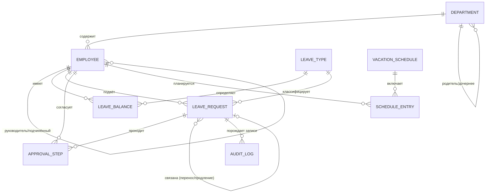

# Требования к системе учёта отпусков

**Проект:** Система учёта отпусков
**Версия документа:** 1.20
**Дата:** 19.10.2026
**Статус:** Черновик для передачи в разработку (Spec-Driven Development); в v1.3 добавлена локальная аутентификация для отдельных сотрудников и режим внедрения без LDAP (см. раздел 13, п. 10); в v1.4 закрыт T-000 — способ шифрования чувствительных данных и отказ от хранения файлов-вложений к заявкам (см. раздел 13, п. 11–12); в v1.5 добавлено FR-AUTH-005 — автоматическое создание первичной учётной записи администратора при первом запуске (пробел, обнаруженный при реализации M1); в v1.6 по итогам ревью PR #134 — параметр длительности блокировки в FR-AUTH-002 и критерий отказа при пустом пароле в FR-AUTH-004; в v1.7 по итогам планирования ветки `T-M1-10`/`T-M1-15` — исключение для вершины иерархии в FR-EMP-001, создание учётной записи вместе с карточкой сотрудника, и разведение маршрута согласования (FR-APPR-001) с правом его выполнить, наследуемым вверх по цепочке подчинения (см. раздел 13, п. 13–15); в v1.8 решением владельца продукта усилена парольная политика FR-AUTH-002 составом символов, запретом логина/e-mail/ФИО и списком распространённых паролей, минимальная длина при этом снижена с 12 до 8 символов (см. раздел 13, п. 16); в v1.9 по итогам ревью PR #140 (T-M1-38) в FR-AUTH-002 введена верхняя граница длины пароля (72 байта в UTF-8 — усечение bcrypt), запрет пробельных символов с уточнением определения специального символа, и различие правила для коротких (2–3 символа, только начало пароля) и длинных (от 4 символов, где угодно) частей ФИО (см. раздел 13, п. 17–19); в v1.10 по итогам второго круга ревью PR #140 верхняя граница длины пароля (72 байта UTF-8, п. 17) распространена на вход, а не только на задание/смену пароля, и добавлена проверка длины `BOOTSTRAP_ADMIN_PASSWORD` при старте приложения (см. раздел 13, п. 20); в v1.11 по итогам второго круга ревью PR #140 из критерия состава символов исключены невидимые Unicode-символы: управляющие/форматирующие (категория C*) запрещены отдельным критерием, как пробельные, а комбинирующие знаки (категория M*) не засчитываются в специальный класс (см. раздел 13, п. 21); в v1.12 решением владельца продукта самообслуживание (свои заявки, свой остаток и история, свои плановые даты в графике) выведено из наличия связанной карточки сотрудника, а не из роли RBAC — прежде матрица раздела 7 лишала этого Бухгалтера при одном поле роли (см. раздел 13, п. 22); в v1.13 по итогам ревью PR #143 (T-M1-46) в FR-AUTH-002 уточнён состав действий, доступных учётной записи до погашения флага обязательной смены первичного пароля (см. раздел 13, п. 23); в v1.14 при планировании `T-M1-23` пронумерованы критерии приёмки десяти требований (FR-AUTH-001…004, FR-EMP-001…004, FR-ADMIN-003, FR-ADMIN-005) для возможности сослаться на конкретный критерий из теста (см. раздел 13, п. 24); в v1.15 по итогам обнаружения при ревью PR #140 (третий круг) добавлен `FR-AUTH-002/13` — нормализация Unicode NFC локального пароля до политики, хэширования и сверки при входе (см. раздел 13, п. 25); в v1.16 по итогам обнаружения при ревью PR #140 (третий круг) добавлен `FR-AUTH-002/14` — выравнивание времени ответа при локальном входе для различий, зависящих от учётной записи, с явной границей: не распространяется на различия по присланному паролю и на сообщение о временной блокировке (см. раздел 13, п. 26); в v1.17 решением владельца продукта при постановке `T-M1-35` добавлен `FR-AUTH-001/3` — выдача только токена доступа с ограниченным сроком, без refresh-токена, который сегодня некому предъявить и нечем отозвать (см. раздел 13, п. 27); в v1.18 исправлена ссылка на закрывающую задачу в п. 27 раздела 13 — названная там `T-M2-17` не существует в этапе M2 (он про остатки и справочники, `FR-BAL-*`, инфраструктура хранения/аудита появляется в M6, а не M2); задача продления сессии с отзывом заведена как `T-M1-56`, сознательно отложенная в M1 (решение владельца продукта); в v1.19 решением владельца продукта при постановке `T-M1-39` зафиксирован неоднородный состав списка распространённых паролей (`FR-AUTH-002/9` не меняется) — кириллический блок не заменяется на источник с измеренной статистикой на этапе разработки, замена отложена до предэксплуатационной подготовки (`T-M7-11`, см. раздел 13, п. 28); в v1.20 при постановке `T-M2-01` исправлено расхождение внутри требований — единица учёта в разделе 6 допускала только календарные и рабочие дни, тогда как `FR-DAYOFF-001` и A-7 требуют учёта отгулов сменных сотрудников в часах (`plan.md` §4 уже закладывал `unit = hours`); в таблицу атрибутов раздела 6 добавлены часы, остальное в разделе 6 не менялось
**Назначение документа:** формальная спецификация для реализации системы силами разработчиков/AI-агентов. Каждое функциональное требование снабжено идентификатором, пользовательской историей и критериями приёмки в нотации EARS (Easy Approach to Requirements Syntax), пригодной для генерации тест-кейсов.

---

## 1. Введение

### 1.1 Назначение системы

Система учёта отпусков (далее — **Система**) автоматизирует процессы планирования, согласования и учёта отсутствий сотрудников компании численностью **до 500 человек**: ежегодных оплачиваемых отпусков, больничных листов, отгулов и командировок. Система заменяет ручной учёт (Excel, бумажные заявления) и обеспечивает соблюдение требований Трудового кодекса РФ (ТК РФ).

### 1.2 Ценность для стейкхолдеров

- **Сотрудник** — видит остаток отпуска, подаёт заявки онлайн, отслеживает статус согласования.
- **Руководитель** — видит календарь отсутствий команды, согласовывает заявки, планирует нагрузку.
- **HR** — формирует и утверждает график отпусков, контролирует соблюдение норм ТК РФ, ведёт справочники.
- **Бухгалтерия** — получает достоверные данные для расчёта отпускных и пособий.
- **Руководство компании** — получает прозрачную отчётность по отсутствиям персонала.

### 1.3 Границы (Scope) — MVP (Фаза 1)

В рамках MVP Система реализуется как **веб-приложение единственного юридического лица** без интеграций учётных систем (1С и т.п.), за единственным исключением, подтверждённым заказчиком как обязательное уже для MVP:

- **аутентификация через LDAP/Active Directory** (см. FR-AUTH-001) как основной способ входа, с настраиваемыми через интерфейс администратора параметрами подключения к каталогу (см. FR-ADMIN-005); локальный вход по e-mail и паролю сохраняется для служебных учётных записей, для отдельных сотрудников по решению HR и как режим внедрения до подключения каталога (см. FR-AUTH-002, FR-AUTH-003).

Выгрузка отчётов в формате, совместимом с загрузкой в 1С:ЗУП, **исключена из MVP** и перенесена в Фазу 2 (см. раздел 1.4, раздел 11.2).

Ввод данных о сотрудниках, штатной структуре и начальных остатках отпусков в остальном выполняется вручную/импортом (CSV/XLSX) администратором.

Система покрывает следующие типы отсутствий:
1. Ежегодный оплачиваемый отпуск (основной; удлинённый/дополнительный — предусмотрен в справочнике, но не требуется для запуска, см. A-3.1).
2. Больничные листы (временная нетрудоспособность).
3. Отгулы (в т.ч. за работу в выходной/праздничный день, компенсация по сменному графику) и служебные командировки.
4. Отпуск без сохранения заработной платы (по заявлению).

Система учитывает сотрудников как со стандартным, так и со **сменным графиком работы** (сменные инженеры) — см. A-7 и FR-DAYOFF-001.

### 1.4 Вне области (Out of Scope) — MVP

- Автоматический расчёт заработной платы и отпускных (система передаёт данные, но не считает суммы).
- Прямой электронный обмен с СФР (ЭЛН) — в MVP номер и даты больничного листа вводятся вручную HR/сотрудником.
- Любая интеграция с 1С:ЗУП/1С:Предприятие — как полная (API, двусторонняя), так и односторонняя выгрузка файла в совместимом формате — зафиксирована целиком как **Фаза 2** (см. раздел 14); в MVP такой выгрузки нет.
- Интеграция с кадровым ЭДО, корпоративным календарём (Outlook/Google) — **Фаза 2**, см. раздел 14.
- Мобильное нативное приложение (в MVP — адаптивный веб-интерфейс).
- Ведение полного графика сменности (функциональность WFM) — Система лишь хранит признак «сменный график» у сотрудника и учитывает отгулы/часы, связанные со сменной работой (см. A-7, FR-DAYOFF-001), но не планирует сами смены.
- Удлинённый/дополнительный отпуск по категориям сотрудников (педагоги, инвалиды, вредные условия, Крайний Север) — на момент запуска в компании таких сотрудников нет; справочник видов отпуска (раздел 6) допускает такую настройку при появлении необходимости в будущем.
- Учёт нескольких юридических лиц с разными производственными календарями — подтверждено, что на MVP компания рассматривается как одно юридическое лицо (см. A-3).
- Хранение файлов-вложений к заявкам (сканы больничных и других подтверждающих документов) — подтверждающий документ фиксируется реквизитами (номер, даты), сам файл в Системе не хранится; для листка нетрудоспособности это, в частности, исключает попадание в Систему сведений о причине нетрудоспособности, что противоречило бы NFR-SEC-002 (см. FR-REQ-005, FR-SICK-001, раздел 13, п. 12).

---

## 2. Глоссарий

| Термин | Определение |
|---|---|
| Рабочий год | Период 12 месяцев, отсчитываемый от даты приёма сотрудника на работу (не всегда совпадает с календарным годом), за который начисляется право на основной отпуск. |
| Расчётный период | Период, за который учитывается стаж, дающий право на отпуск (исключаются периоды отпуска без содержания свыше 14 дней, прогулы и т.д.). |
| График отпусков | Обязательный документ (унифицированная форма Т-7 или её аналог), утверждаемый работодателем не позднее чем за две недели до начала календарного года, отражающий плановые даты отпусков всех сотрудников. |
| ЭЛН | Электронный листок нетрудоспособности. |
| Производственный календарь | Справочник рабочих, выходных и праздничных дней на календарный год, утверждаемый Правительством РФ. |
| Остаток отпуска | Количество неиспользованных дней отпуска, накопленных сотрудником на текущий момент. |
| Отгул | Дополнительный день(-дни) отдыха, предоставляемый вне графика отпусков (компенсация переработки, работы в выходной/праздничный день, по личным обстоятельствам). |
| EARS | Формат записи критериев приёмки: WHEN/IF/WHILE/WHERE <условие>, THE SYSTEM SHALL <действие>. |

---

## 3. Роли и участники системы (Actors)

| Роль | Описание |
|---|---|
| **Сотрудник** | Любой работник компании с учётной записью в Системе; подаёт заявки на отсутствие, видит свой остаток и историю. |
| **Руководитель** | Непосредственный руководитель сотрудника; согласовывает заявки своих подчинённых, видит календарь отсутствий отдела. |
| **HR-администратор (HRD)** | Ведёт справочники (сотрудники, подразделения, виды отпусков, производственный календарь), формирует и **финально утверждает график отпусков** (на этапе MVP это делает директор по персоналу — HRD), является вторым (финальным) согласующим по заявкам, формирует отчётность. |
| **Бухгалтер** | Роль только для чтения ЧУЖИХ данных: просмотр и выгрузка данных об утверждённых отсутствиях для целей расчёта. По своим данным — обычный сотрудник: подаёт заявки на своё отсутствие, видит свой остаток и вносит свои плановые даты в график наравне с любым сотрудником, у которого есть карточка (раздел 7). |
| **Администратор системы** | Технический администратор: управление учётными записями, ролями, настройками безопасности, интеграциями (LDAP, будущие интеграции Фазы 2). |

Один и тот же физический сотрудник может одновременно иметь роль «Сотрудник» и «Руководитель» (для собственных подчинённых).

---

## 4. Предположения и ограничения

- **A-1.** Юрисдикция — Российская Федерация; все нормативные ссылки — на ТК РФ и связанные федеральные законы.
- **A-2.** Численность — до 500 активных сотрудников одновременно; проектные нагрузочные требования рассчитываются исходя из этого порога с запасом ×2.
- **A-3.** Компания — одно юридическое лицо с несколькими подразделениями/отделами (организационная иерархия — дерево подразделений с одним руководителем на каждое); подтверждено заказчиком для MVP, несколько юрлиц не рассматриваются в текущей фазе.
  - **A-3.1.** На момент запуска в компании нет сотрудников с удлинённым или дополнительным оплачиваемым отпуском (льготные категории) — справочник (раздел 6) поддерживает такую настройку на будущее, но заполнение конкретных категорий не требуется для MVP.
- **A-4.** В MVP не предполагается интеграция с учётными системами (1С:ЗУП, СФР, корпоративный календарь) — данные вводятся и поддерживаются вручную, **за исключением** LDAP-аутентификации (A-8), которая входит в MVP. Выгрузка, совместимая с 1С:ЗУП (в любом виде), в MVP не реализуется и целиком отнесена к Фазе 2.
- **A-5.** У каждого активного пользователя Системы есть корпоративный e-mail для аутентификации и уведомлений (подтверждено заказчиком — исключений типа «сотрудник без e-mail» на MVP нет).
- **A-6.** Архитектура Системы должна допускать последующее добавление интеграций (1С:ЗУП, СФР, корпоративный календарь) без переработки модели данных (см. раздел 14).
- **A-7.** В компании есть сотрудники со **сменным графиком работы** (сменные инженеры) с **почасовой оплатой труда**; для них отсутствия (прежде всего отгулы) учитываются не только в календарных днях, но и в часах/сменах (см. FR-DAYOFF-001). Продолжительность и порядок предоставления основного отпуска (28 календарных дней) для них не отличается от прочих сотрудников и не зависит от почасовой оплаты — сменность и почасовая оплата влияют только на учёт отгулов и отображение в общем календаре (FR-CAL-001). Расчёт самой почасовой оплаты и переработки в денежном выражении — вне области Системы (см. раздел 1.4, «Автоматический расчёт заработной платы»); Система лишь хранит и предоставляет данные о часах/сменах отсутствия и накопленной компенсации. Полное планирование графика сменности — вне области Системы (см. раздел 1.4).
- **A-8.** Основной способ аутентификации пользователей в MVP — корпоративный каталог **LDAP/Active Directory** по атрибуту **e-mail** (см. FR-AUTH-001); параметры подключения к серверу LDAP (адрес, порт, base DN, служебная учётная запись для bind) настраиваются через интерфейс администратора, без изменения кода (см. FR-ADMIN-005).
  - **A-8.1.** Наряду с LDAP Система поддерживает **локальную аутентификацию по корпоративному e-mail и паролю** (FR-AUTH-002) в трёх случаях: для служебных/административных учётных записей (первая из них создаётся автоматически при первом запуске — см. FR-AUTH-005); для отдельных сотрудников, которым HR-администратор явно назначил локальный способ входа в карточке (например, сотрудника нет в каталоге); и для всех пользователей, пока подключение к LDAP не настроено — режим внедрения (FR-AUTH-003).
  - **A-8.2.** Локальная аутентификация не ослабляет контроль доступа: деактивированный сотрудник (FR-EMP-004) или отключённая учётная запись не могут войти в Систему независимо от способа входа (FR-AUTH-004).
- **A-9.** Администратор БД — доверенное лицо: включается в перечень лиц, допущенных к обработке персональных данных, подписывает обязательство о неразглашении, его доступ логируется. Техническая защита данных от администратора БД (например, колоночное шифрование) в MVP не предусмотрена — см. NFR-SEC-001, раздел 13, п. 11.

---

## 5. Бизнес-правила (нормативная база)

Система должна обеспечивать соблюдение следующих норм ТК РФ (значения по умолчанию — настраиваемые параметры, не хардкод):

| № | Правило | Норма |
|---|---|---|
| BR-1 | Продолжительность основного оплачиваемого отпуска | 28 календарных дней в год (ст. 115 ТК РФ); для отдельных категорий сотрудников — удлинённый отпуск (значение настраивается по категории). |
| BR-2 | Право на первый отпуск | Возникает через 6 месяцев непрерывной работы у данного работодателя (ст. 122 ТК РФ), может быть предоставлен раньше по соглашению сторон. |
| BR-3 | Утверждение графика отпусков | Не позднее чем за 2 недели до начала календарного года, на который составляется график (не позднее 17 декабря), обязателен и для работодателя, и для работника (ст. 123 ТК РФ). |
| BR-4 | Уведомление о начале отпуска | Работник должен быть извещён о времени начала отпуска не позднее чем за 2 недели до его начала (ст. 123 ТК РФ). |
| BR-5 | Разделение отпуска на части | Допускается по соглашению сторон; при этом хотя бы одна из частей должна быть не менее 14 календарных дней (ст. 125 ТК РФ). |
| BR-6 | Продление/перенос отпуска | Обязателен при временной нетрудоспособности сотрудника в период отпуска, а также в иных случаях, предусмотренных ТК РФ (ст. 124). Отпуск должен быть использован не позднее 12 месяцев после окончания рабочего года, за который он предоставляется. |
| BR-7 | Замена части отпуска денежной компенсацией | По заявлению работника часть отпуска, превышающая 28 календарных дней, может быть заменена денежной компенсацией (ст. 126 ТК РФ) — фиксируется в Системе, расчёт суммы — вне Системы. |
| BR-8 | Компенсация при увольнении | При увольнении выплачивается компенсация за все неиспользованные отпуска (ст. 127 ТК РФ) — Система должна показывать актуальный остаток на любую дату. |
| BR-9 | Отпуск без сохранения зарплаты | По заявлению работника; для отдельных категорий и оснований предоставление обязательно (ст. 128 ТК РФ), длительность — по заявлению/основанию. |
| BR-10 | Листок нетрудоспособности | Порядок исчисления и подтверждения — Федеральный закон № 255-ФЗ; с 2022 года — только электронный листок нетрудоспособности (ЭЛН). |
| BR-11 | Производственный календарь | Расчёт рабочих/выходных/праздничных дней — на основании ежегодного постановления Правительства РФ; должен обновляться в Системе ежегодно. |

> Все значения (28 дней, 2 недели, 14 дней и т.д.) должны храниться как **настраиваемые параметры**, а не быть зашиты в коде, поскольку возможны изменения законодательства и отраслевые/категориальные исключения.

---

## 6. Справочник видов отсутствий

Система должна поддерживать расширяемый справочник видов отсутствий со следующими атрибутами конфигурации у каждого вида:

| Атрибут | Описание |
|---|---|
| Код и наименование | Уникальный идентификатор и человекочитаемое название. |
| Оплачиваемость | Оплачиваемый / неоплачиваемый / частично оплачиваемый. |
| Единица учёта | Календарные дни / рабочие дни / часы (часы — для видов, учитываемых в часах у сотрудников со сменным графиком, прежде всего отгул: `FR-DAYOFF-001`, A-7). |
| Уменьшает остаток основного отпуска | Да/Нет. |
| Требует подтверждающий документ | Да/Нет — требует ввода реквизитов документа (номер, даты, например ЭЛН); файл документа Система не хранит (см. раздел 1.4). |
| Требует согласования | Да/Нет, и по какому маршруту. |
| Годовой лимит | Число дней в год (если применимо), способ переноса неиспользованного остатка. |
| Учитывать выходные/праздники внутри периода | Да/Нет. |

Предустановленный (начальный) набор видов отсутствий:

1. Основной оплачиваемый отпуск.
2. Дополнительный оплачиваемый отпуск (ненормированный день, вредные условия, северные и приравненные территории — настраивается по категории сотрудника; **на MVP не заполняется данными**, см. A-3.1, но справочник должен поддерживать добавление таких категорий без изменения кода).
3. Отпуск без сохранения заработной платы.
4. Учебный отпуск.
5. Отпуск по беременности и родам / по уходу за ребёнком.
6. Больничный (временная нетрудоспособность).
7. Отгул (компенсация переработки/работы в выходной или праздничный день, по личным обстоятельствам).
8. Командировка (не расходует остаток отпуска, но блокирует сотрудника в календаре присутствия).

---

## 7. Матрица доступа (RBAC) — сводно

| Действие | Сотрудник | Руководитель | HR | Бухгалтер | Админ |
|---|:---:|:---:|:---:|:---:|:---:|
| Подать заявку на своё отсутствие | ✅ | ✅ | ✅ | ✅ | ✅ |
| Подать заявку от имени сотрудника (по просьбе/в его отсутствие) | — | ✅ (своя команда) | ✅ | — | — |
| Согласовать заявку подчинённого | — | ✅ (своя команда) | ✅ (финально) | — | — |
| Просмотр своего остатка/истории | ✅ | ✅ | ✅ | ✅ | ✅ |
| Просмотр остатка/истории любого сотрудника | — | ✅ (своя команда) | ✅ (все) | ✅ (все, read-only) | ✅ |
| Внести свои плановые даты в график на следующий год (FR-SCHED-002) | ✅ | ✅ | ✅ | ✅ | ✅ |
| Формирование и утверждение графика отпусков | — | Согласование (своя команда) | ✅ | — | — |
| Ведение справочников (виды отпусков, подразделения, календарь) | — | — | ✅ | — | ✅ |
| Экспорт отчётов | — | Своя команда | ✅ | ✅ | ✅ |
| Управление учётными записями и ролями | — | — | Частично (ввод сотрудников) | — | ✅ |
| Просмотр журнала аудита | — | — | Частично | — | ✅ |

Детальная матрица прав (CRUD по сущностям) фиксируется отдельно в техническом проекте на этапе реализации.

**Правило самообслуживания.** Строки выше, отмеченные ✅ во всех пяти столбцах («подать заявку на своё отсутствие», «просмотр своего остатка/истории», «внести свои плановые даты»), определяются не ролью RBAC (`accounts.role`), а наличием у учётной записи связанной карточки сотрудника (`accounts.employee_id IS NOT NULL`) — симметрично тому, как роль «Руководитель» выводится из наличия подчинённых (`employees.manager_id`), а не хранится в `role`. Любая учётная запись со своей карточкой сотрудника — включая роли `hr_admin`, `accountant`, `system_admin` — имеет доступ к перечисленным действиям над СВОИМИ данными наравне с ролью `employee`; ограничения этих ролей (read-only чужих данных для `accountant`, административные функции `system_admin`) касаются доступа к данным ДРУГИХ сотрудников и не сужают их самообслуживание. Служебные учётные записи без карточки (`FR-AUTH-005`, `employee_id IS NULL`, например bootstrap-администратор) самообслуживания не имеют — отпуска у них нет.

---

## 8. Функциональные требования

Формат: `[ID] Название` → **User Story** → **Критерии приёмки (EARS)**.

Критерий приёмки, на который нужно сослаться (из теста, из другого документа, из описания PR), получает номер вида `` `FR-XXX-NNN/K` `` — порядковый номер в пределах СВОЕГО требования, в порядке следования критериев в этом документе (`T-M1-23`). Формат использует тот же разделитель `/`, что и принятое в проекте сокращение нескольких ID требований одного раздела (`FR-ADMIN-002/003`, `FR-BAL-002/004`) — читается по контексту: три и более цифры после `/` — это номер другого требования, одна-две цифры — номер критерия внутри уже названного. Правила нумерации:
- номер выдаётся только добавлением нового критерия в конец списка требования — не вставкой в середину со сдвигом остальных;
- номер не переиспользуется и не перенумеровывается, даже если критерий с этим номером позже уберут из требования (промежуток в нумерации — нормальное следствие, не ошибка);
- правка текста уже пронумерованного критерия (без изменения его смысла) номер не меняет — новый номер получает только критерий, которого раньше не было;
- иначе ссылка из теста, написанная сегодня, через несколько правок требования стала бы незаметно указывать не на тот критерий.

Пронумерованы десять требований области `T-M1-23` (`FR-AUTH-001`…`004`, `FR-EMP-001`…`004`, `FR-ADMIN-003`, `FR-ADMIN-005`); остальные требования документа номеров критериев пока не несут — добавляются по мере необходимости сослаться на конкретный критерий, а не всем сразу впрок.

### 8.1 Учёт сотрудников и организационной структуры (FR-EMP)

**FR-EMP-001. Карточка сотрудника**
Как HR-администратор, я хочу вести карточки сотрудников с ключевыми кадровыми атрибутами, чтобы Система могла корректно рассчитывать остатки отпусков и маршруты согласования.
- `FR-EMP-001/1`. WHEN HR-администратор создаёт карточку сотрудника, THE SYSTEM SHALL требовать заполнения обязательных полей: ФИО, табельный номер, подразделение, должность, дата приёма на работу, корпоративный e-mail (используется также как логин для LDAP-аутентификации, см. FR-AUTH-001), график работы (стандартный / сменный, см. A-7).
- `FR-EMP-001/2`. THE SYSTEM SHALL требовать указания непосредственного руководителя, ЗА ИСКЛЮЧЕНИЕМ карточки, для которой вышестоящего руководителя в Системе нет (вершина иерархии, например генеральный директор) — для такой карточки поле остаётся пустым. Системе допускается более одной вершины иерархии одновременно (например, на период реорганизации или для параллельных верхнеуровневых цепочек подчинения) — Система не требует единственного корня дерева.
- `FR-EMP-001/3`. THE SYSTEM SHALL хранить необязательное поле «категория для расчёта удлинённого/дополнительного отпуска» для совместимости со справочником видов отпуска (раздел 6), не требуя его заполнения на этапе MVP (см. A-3.1).
- `FR-EMP-001/4`. WHEN HR-администратор создаёт карточку сотрудника, THE SYSTEM SHALL требовать выбора способа входа сотрудника в Систему: «корпоративный каталог (LDAP)» — значение по умолчанию — либо «локальный пароль» (см. FR-AUTH-002, A-8.1); WHERE выбран локальный пароль, THE SYSTEM SHALL позволять задать первичный пароль с обязательной сменой при первом входе.
- `FR-EMP-001/5`. WHEN создаётся карточка сотрудника, THE SYSTEM SHALL создавать связанную учётную запись для входа в Систему с ролью по умолчанию «Сотрудник» (раздел 7: управление учётными записями и ролями — HR частично, в объёме ввода сотрудников; Администратор Системы — в полном объёме, включая последующее изменение роли).
- `FR-EMP-001/6`. WHEN обязательное поле не заполнено, THE SYSTEM SHALL блокировать сохранение карточки и показывать список отсутствующих полей.
- `FR-EMP-001/7`. WHERE сотруднику установлен сменный график работы, THE SYSTEM SHALL отображать этот признак в карточке и учитывать его при регистрации отгулов (FR-DAYOFF-001) и в общем календаре отсутствий (FR-CAL-001).

**FR-EMP-002. Организационная структура**
Как HR-администратор, я хочу вести иерархию подразделений с одним ответственным руководителем на каждое, чтобы Система автоматически определяла маршрут согласования заявок.
- `FR-EMP-002/1`. THE SYSTEM SHALL хранить структуру подразделений в виде дерева с возможностью произвольной вложенности.
- `FR-EMP-002/2`. WHEN сотрудник перемещается в другое подразделение или меняется его руководитель, THE SYSTEM SHALL применять новый маршрут согласования ко всем заявкам, поданным после даты изменения, не затрагивая уже согласованные заявки.

**FR-EMP-003. Массовый импорт сотрудников**
Как HR-администратор, я хочу загрузить список сотрудников и их начальные остатки отпусков файлом (CSV/XLSX), чтобы не вводить данные вручную по одному при запуске Системы.
- `FR-EMP-003/1`. WHEN HR-администратор загружает файл импорта, THE SYSTEM SHALL проверять формат и обязательные поля и выводить построчный отчёт об ошибках без прерывания загрузки корректных строк.
- `FR-EMP-003/2`. WHEN импорт завершён, THE SYSTEM SHALL показывать сводку: количество успешно загруженных, количество отклонённых строк с причинами.

**FR-EMP-004. Деактивация сотрудника (увольнение)**
Как HR-администратор, я хочу деактивировать карточку сотрудника при увольнении, чтобы он не отображался в активных списках, но его история сохранялась.
- `FR-EMP-004/1`. WHEN HR-администратор указывает дату увольнения, THE SYSTEM SHALL зафиксировать итоговый остаток неиспользованного отпуска на дату увольнения и заблокировать подачу новых заявок от имени этого сотрудника.
- `FR-EMP-004/2`. THE SYSTEM SHALL сохранять полную историю отсутствий уволенного сотрудника доступной для отчётности не менее установленного срока хранения (см. NFR-DATA-001).

---

### 8.2 Расчёт и учёт остатков отпуска (FR-BAL)

**FR-BAL-001. Начисление дней основного отпуска**
Как Система, я должна автоматически рассчитывать накопленный остаток дней основного отпуска сотрудника, чтобы исключить ручные ошибки расчёта.
- THE SYSTEM SHALL рассчитывать накопленный остаток пропорционально отработанному в рабочем году времени, исходя из нормы отпуска, установленной для сотрудника (по умолчанию 28 календарных дней в год).
- WHEN в расчётном периоде сотрудника есть периоды, исключаемые из стажа, дающего право на отпуск (например, отпуск без содержания свыше 14 дней подряд в рабочем году), THE SYSTEM SHALL корректировать дату окончания рабочего года и накопление пропорционально.
- WHILE сотрудник имеет стаж работы менее 6 месяцев, THE SYSTEM SHALL отображать накопленный остаток, но помечать его как «отпуск авансом» при попытке использовать дни сверх пропорционально накопленных, требуя дополнительного подтверждения HR.

**FR-BAL-002. Отображение остатка сотруднику**
Как сотрудник, я хочу видеть свой актуальный остаток отпуска по видам, чтобы планировать даты заявки.
- WHEN сотрудник открывает раздел «Мой отпуск», THE SYSTEM SHALL отображать остаток по каждому применимому виду оплачиваемого отпуска на текущую дату, а также историю начислений и использования.

**FR-BAL-003. Пересчёт остатка при изменении данных**
- WHEN HR-администратор изменяет кадровые параметры сотрудника, влияющие на норму отпуска (категория, дата приёма, ставка занятости), THE SYSTEM SHALL пересчитывать остаток и сохранять запись в истории изменений с указанием автора и причины.

**FR-BAL-004. Ручная корректировка остатка**
Как HR-администратор, я хочу иметь возможность вручную скорректировать остаток отпуска сотрудника (например, при переносе данных из прошлой системы учёта), чтобы обеспечить точность на дату запуска Системы.
- WHEN HR-администратор вносит ручную корректировку остатка, THE SYSTEM SHALL требовать указания причины корректировки и сохранять запись в журнале аудита.

---

### 8.3 График отпусков (FR-SCHED)

**FR-SCHED-001. Формирование проекта графика**
Как HR-администратор, я хочу сформировать проект графика отпусков на следующий календарный год на основе пожеланий сотрудников, чтобы утвердить его в срок, установленный ТК РФ.
- THE SYSTEM SHALL предоставлять HR-администратору интерфейс сбора плановых дат отпусков от сотрудников/руководителей на предстоящий календарный год.
- WHEN приближается установленный законодательством срок утверждения графика (по умолчанию 17 декабря текущего года), THE SYSTEM SHALL заблаговременно (настраиваемо, по умолчанию за 30 дней) напоминать HR-администратору и сотрудникам о необходимости внести плановые даты.

**FR-SCHED-002. Согласование планов сотрудника**
Как сотрудник, я хочу указать желаемые даты отпуска на следующий год, чтобы они попали в проект графика.
- WHEN сотрудник указывает плановые даты, THE SYSTEM SHALL проверять, что суммарное количество дней не превышает прогнозируемый остаток на начало планового года, и предупреждать (не блокировать) при превышении.

**FR-SCHED-003. Утверждение графика**
Как HR-администратор, я хочу утвердить итоговый график отпусков, чтобы он стал обязательным документом для работодателя и сотрудников.
- WHEN HR-администратор инициирует утверждение графика, THE SYSTEM SHALL зафиксировать дату утверждения, ответственное лицо и версию документа, после чего график переходит в статус «Утверждён» и становится доступным только для чтения всем сотрудникам.
- THE SYSTEM SHALL рассматривать утверждение как факт, зафиксированный внутри Системы (действие пользователя HRD + запись в журнале аудита, FR-AUDIT-001), **не требуя** усиленной квалифицированной электронной подписи (УКЭП/ЭЦП) документа на этапе MVP.
- IF в утверждённом графике необходимо изменить дату отпуска конкретного сотрудника, THEN THE SYSTEM SHALL требовать отдельного согласованного заявления (см. FR-REQ-004) и фиксировать факт отклонения от графика с указанием причины.
- THE SYSTEM SHALL формировать печатную/экспортируемую форму графика отпусков (аналог унифицированной формы Т-7).

**FR-SCHED-004. Уведомление о начале отпуска**
Как Система, я должна напомнить сотруднику и его руководителю о приближающемся начале отпуска, чтобы соблюсти требование об извещении не позднее чем за 2 недели.
- WHEN до плановой даты начала отпуска остаётся установленное количество дней (по умолчанию 14 календарных дней), THE SYSTEM SHALL отправлять уведомление сотруднику и фиксировать факт уведомления (аналог извещения под роспись) в истории.

---

### 8.4 Заявки на отпуск (FR-REQ)

**FR-REQ-001. Подача заявки на отпуск**
Как сотрудник, я хочу подать заявку на отпуск с указанием дат, чтобы получить согласование руководителя и HR.
- WHEN сотрудник создаёт заявку на отпуск, THE SYSTEM SHALL требовать выбора вида отпуска, даты начала, даты окончания (или количества дней) и автоматически рассчитывать количество календарных дней с учётом производственного календаря (где применимо).
- IF запрашиваемое количество дней превышает доступный остаток по данному виду отпуска, THEN THE SYSTEM SHALL показывать предупреждение и требовать явного подтверждения (например, отпуск авансом) либо блокировать подачу — согласно настройке вида отпуска.
- WHEN заявка успешно создана, THE SYSTEM SHALL присваивать ей статус «На согласовании» и направлять её по установленному маршруту (см. FR-APPR).

**FR-REQ-002. Разделение отпуска на части**
- IF сотрудник делит отпуск на части в рамках рабочего года, THEN THE SYSTEM SHALL проверять, что хотя бы одна из частей составляет не менее установленного минимума (по умолчанию 14 календарных дней), и предупреждать при нарушении (без обязательной блокировки, так как возможны исключения по соглашению сторон).

**FR-REQ-003. Отмена/отзыв заявки**
Как сотрудник, я хочу отозвать поданную, но ещё не согласованную заявку, чтобы исправить ошибку.
- WHEN заявка находится в статусе «На согласовании», THE SYSTEM SHALL позволять автору отозвать её без согласования.
- IF заявка уже согласована и требуется её отмена, THEN THE SYSTEM SHALL требовать создания заявки на отмену/перенос с повторным маршрутом согласования (см. FR-REQ-004).

**FR-REQ-004. Перенос отпуска**
Как сотрудник, я хочу перенести согласованный отпуск (например, по болезни), чтобы соблюсти нормы ст. 124 ТК РФ.
- WHEN сотрудник или HR инициирует перенос ранее согласованного отпуска, THE SYSTEM SHALL создавать связанную заявку на перенос, требующую нового согласования, и сохранять связь с исходной заявкой в истории.
- THE SYSTEM SHALL предупреждать, если планируемая новая дата отпуска выходит за пределы 12 месяцев после окончания рабочего года, за который предоставляется отпуск.

**FR-REQ-005. Реквизиты подтверждающего документа**
- WHERE вид отсутствия требует подтверждающего документа (например, больничный), THE SYSTEM SHALL позволять ввести реквизиты документа (номер, даты) и блокировать финальное согласование заявки до заполнения обязательных реквизитов. Файл документа в Системе не хранится (см. раздел 1.4, NFR-SEC-002).

---

### 8.5 Больничные листы (FR-SICK)

**FR-SICK-001. Регистрация больничного**
Как сотрудник (или HR от его имени), я хочу зарегистрировать больничный лист, чтобы дни отсутствия были корректно учтены и не расходовали остаток отпуска.
- WHEN создаётся запись о больничном, THE SYSTEM SHALL требовать номер ЭЛН, дату начала и дату окончания нетрудоспособности.
- THE SYSTEM SHALL учитывать дни больничного как отдельный вид отсутствия, не уменьшающий остаток основного оплачиваемого отпуска.
- THE SYSTEM SHALL NOT хранить скан/файл листка нетрудоспособности и сведения о диагнозе/причине нетрудоспособности — только номер и даты (см. раздел 1.4, NFR-SEC-002).

**FR-SICK-002. Больничный в период отпуска**
- WHEN период зарегистрированного больничного пересекается с датами уже согласованного отпуска, THE SYSTEM SHALL автоматически предлагать продление отпуска на количество дней пересечения либо перенос неиспользованной части, с уведомлением сотрудника, руководителя и HR.

**FR-SICK-003. Уведомление HR и бухгалтерии**
- WHEN больничный лист зарегистрирован и подтверждён HR, THE SYSTEM SHALL делать данные доступными для выгрузки бухгалтером (см. FR-REPORT).

---

### 8.6 Отгулы и командировки (FR-DAYOFF)

**FR-DAYOFF-001. Заявка на отгул**
Как сотрудник, я хочу оформить отгул (в т.ч. в счёт компенсации работы в выходной/праздничный день или переработки по сменному графику), чтобы отсутствие было формально зафиксировано.
- WHEN сотрудник создаёт заявку на отгул, THE SYSTEM SHALL требовать указания основания (компенсация переработки / работа в выходной или праздничный день / компенсация по сменному графику / личные обстоятельства) и, при наличии, связанной даты отработанного выходного дня или смены.
- WHERE основанием является компенсация за работу в выходной/праздничный день или переработку, THE SYSTEM SHALL вести отдельный счётчик накопленной компенсации (в днях — для сотрудников со стандартным графиком, либо в часах/сменах — для сотрудников со сменным графиком, согласно признаку из FR-EMP-001) и уменьшать его при использовании.
- WHERE сотрудник имеет сменный график работы, THE SYSTEM SHALL допускать оформление отгула на часть смены (не только на целую календарную дату), с указанием количества часов.
- IF накопленный остаток компенсации (дней или часов) сотрудника недостаточен для запрашиваемого отгула, THEN THE SYSTEM SHALL показывать предупреждение при подаче заявки, аналогично FR-REQ-001.

**FR-DAYOFF-002. Заявка на командировку**
Как сотрудник, я хочу зарегистрировать командировку, чтобы коллеги и руководитель видели моё отсутствие на рабочем месте в календаре.
- WHEN создаётся заявка на командировку, THE SYSTEM SHALL требовать даты, место назначения и цель; THE SYSTEM SHALL отображать период командировки в общем календаре отсутствий, не уменьшая остаток отпуска.
- THE SYSTEM SHALL направлять заявку на командировку по тому же маршруту согласования, что и заявку на отпуск (настраиваемо).

---

### 8.7 Маршруты согласования (FR-APPR)

**FR-APPR-001. Базовый маршрут согласования**
Как Система, я должна направлять заявку сотрудника последовательно непосредственному руководителю, а затем HR, чтобы обеспечить двухступенчатый контроль.
- WHEN заявка подана, THE SYSTEM SHALL направлять её на согласование непосредственному руководителю сотрудника (`employees.manager_id`); после закрытия этого шага — на финальное согласование HR-администратору (маршрут настраивается по виду отсутствия и подразделению).
- THE SYSTEM SHALL считать шаг «руководитель» пройденным, если его согласовал либо непосредственный руководитель, либо любой вышестоящий руководитель по цепочке подчинения (право согласования наследуется вверх по иерархии автоматически, без отдельной настройки). Маршрут при этом не меняется: по умолчанию заявка адресована непосредственному руководителю, вышестоящих не уведомляют и не требуют от них действия, пока шаг не просрочен (см. FR-APPR-004) — иначе каждая заявка требовала бы внимания всей цепочки подчинения. Шаг «руководитель» в маршруте один: согласование вышестоящим не пропускает и не добавляет шагов маршрута.
- IF руководитель отклоняет заявку, THEN THE SYSTEM SHALL переводить её в статус «Отклонено» с обязательным указанием причины и уведомлять автора; последующие этапы согласования не выполняются.

**FR-APPR-002. Согласование заявки руководителя**
- WHERE заявку подаёт сам руководитель, THE SYSTEM SHALL направлять её на согласование вышестоящему руководителю (или напрямую HR, если вышестоящего нет), минуя самосогласование; право вышестоящего согласовать эту заявку определяется тем же наследованием по цепочке, что и в FR-APPR-001.

**FR-APPR-003. Делегирование согласования**
Как руководитель, я хочу назначить временного заместителя для согласования заявок на время своего отсутствия, чтобы не блокировать процесс.
- WHEN руководитель находится в отпуске/недоступен и делегирование настроено, THE SYSTEM SHALL направлять заявки, требующие его согласования, назначенному заместителю.
- Делегирование не заменяется и не поглощается наследованием права по цепочке подчинения (FR-APPR-001): наследование действует вверх по иерархии автоматически и без настройки, тогда как делегирование передаёт право согласования вбок — заместителю, который не обязан быть вышестоящим руководителем этого сотрудника.

**FR-APPR-004. Эскалация по таймауту**
- IF заявка не согласована и не отклонена в течение установленного срока (по умолчанию 3 рабочих дня, настраиваемо), THEN THE SYSTEM SHALL отправлять напоминание согласующему и уведомление HR о просроченном согласовании.

**FR-APPR-005. История согласования**
- THE SYSTEM SHALL хранить полную историю каждой заявки: кто, когда, какое действие совершил (создал/согласовал/отклонил/отозвал), с возможностью просмотра сотрудником статуса своей заявки в реальном времени.
- THE SYSTEM SHALL фиксировать в истории фактически действовавшего согласующего, а не адресата шага маршрута: если шаг «руководитель» закрыл не непосредственный руководитель, а вышестоящий по цепочке (FR-APPR-001) либо заместитель по делегированию (FR-APPR-003), в записи истории указывается именно он.

---

### 8.8 Уведомления (FR-NOTIF)

**FR-NOTIF-001. Уведомления по e-mail**
- WHEN изменяется статус заявки (согласована/отклонена/требует действия), THE SYSTEM SHALL отправлять уведомление по e-mail автору заявки и/или согласующему в зависимости от типа события.

**FR-NOTIF-002. Напоминания**
- THE SYSTEM SHALL отправлять автоматические напоминания: о приближающемся начале отпуска (FR-SCHED-004), о просроченном согласовании (FR-APPR-004), о необходимости заполнить график отпусков (FR-SCHED-001).

**FR-NOTIF-003. Настройка уведомлений**
- WHERE пользователь хочет ограничить состав уведомлений, THE SYSTEM SHALL предоставлять базовые настройки подписки (не отключая критичные уведомления о статусе собственных заявок).

---

### 8.9 Календарь отсутствий команды (FR-CAL)

**FR-CAL-001. Общий календарь**
Как руководитель, я хочу видеть календарь отсутствий своей команды, чтобы планировать нагрузку и избегать одновременного отсутствия ключевых сотрудников.
- THE SYSTEM SHALL отображать календарное/список-представление отсутствий (все виды) сотрудников подразделения с фильтрацией по периоду, сотруднику и виду отсутствия.
- THE SYSTEM SHALL визуально выделять пересечения дат отсутствия нескольких сотрудников одного подразделения (для ручного контроля руководителем; жёсткого ограничения на количество одновременно отсутствующих в MVP не накладывается).

**FR-CAL-002. Производственный календарь**
- THE SYSTEM SHALL хранить и применять при расчётах производственный календарь (рабочие/выходные/праздничные дни) отдельно на каждый календарный год, с возможностью ручного обновления HR/администратором ежегодно.

---

### 8.10 Отчётность и экспорт (FR-REPORT)

**FR-REPORT-001. Отчёт по остаткам отпусков**
Как HR/бухгалтер, я хочу выгрузить отчёт по остаткам отпусков сотрудников на дату, чтобы использовать его для расчётов и аудита.
- WHEN пользователь с соответствующей ролью запрашивает отчёт, THE SYSTEM SHALL формировать выгрузку (XLSX/CSV) с полями: сотрудник, подразделение, вид отпуска, начислено, использовано, остаток на дату.

**FR-REPORT-002. Отчёт по согласованным отсутствиям за период**
- THE SYSTEM SHALL формировать отчёт по всем согласованным отсутствиям (все виды) за выбранный период, пригодный для передачи в расчёт заработной платы (даты, вид, количество дней, статус).

**FR-REPORT-003. Печатная форма графика отпусков**
- THE SYSTEM SHALL формировать утверждённый график отпусков в печатном/экспортируемом виде, аналогичном унифицированной форме Т-7 (см. FR-SCHED-003).

**FR-REPORT-004. Отчёт по нарушениям норм**
Как HR, я хочу видеть список потенциальных нарушений (например, отпуск не использован более 12 месяцев, отпуск разделён без части ≥14 дней), чтобы своевременно их устранять.
- THE SYSTEM SHALL формировать отчёт-предупреждение по сотрудникам с накопленным остатком отпуска, не использованным в течение установленного срока (настраиваемо, по умолчанию 11 месяцев с начала рабочего года).

> Выгрузка в формате, совместимом с 1С:ЗУП, в MVP не реализуется (исключена заказчиком из объёма MVP) — см. раздел 11.2, Фаза 2.

---

### 8.11 Администрирование справочников (FR-ADMIN)

**FR-ADMIN-001. Управление видами отсутствий**
- THE SYSTEM SHALL предоставлять HR-администратору интерфейс создания/редактирования видов отсутствий с атрибутами, описанными в разделе 6.

**FR-ADMIN-002. Управление подразделениями**
- THE SYSTEM SHALL предоставлять интерфейс управления деревом подразделений и назначения руководителей.

**FR-ADMIN-003. Управление производственным календарём**
- `FR-ADMIN-003/1`. THE SYSTEM SHALL предоставлять интерфейс загрузки/редактирования производственного календаря на календарный год.

**FR-ADMIN-004. Управление параметрами бизнес-правил**
- THE SYSTEM SHALL предоставлять интерфейс настройки параметров, перечисленных в разделе 5 (длительность отпуска по умолчанию, сроки уведомлений, минимальная часть при разделении, срок эскалации согласования и т.д.), без необходимости изменения кода.

**FR-ADMIN-005. Настройка параметров подключения к LDAP**
Как администратор Системы, я хочу настраивать параметры подключения к корпоративному LDAP-серверу через интерфейс, чтобы не зависеть от изменений в коде или конфигурационных файлах при смене инфраструктуры.
- `FR-ADMIN-005/1`. THE SYSTEM SHALL предоставлять администратору интерфейс настройки параметров подключения к LDAP/Active Directory: адрес и порт сервера, base DN, учётные данные служебной записи для bind, атрибут сопоставления пользователя (по умолчанию — e-mail, см. A-8), с возможностью проверить соединение («тестовое подключение») без сохранения некорректных параметров.
- `FR-ADMIN-005/2`. WHEN администратор сохраняет некорректные или недоступные параметры подключения, THE SYSTEM SHALL показывать понятное сообщение об ошибке и не применять изменения, пока соединение не будет подтверждено (или изменения не будут явно сохранены с предупреждением).

---

### 8.12 Аутентификация и доступ (FR-AUTH)

**FR-AUTH-001. Вход через LDAP**
Как сотрудник, я хочу входить в Систему с помощью своей корпоративной учётной записи (LDAP/Active Directory), чтобы не заводить и не запоминать отдельный пароль.
- `FR-AUTH-001/1`. THE SYSTEM SHALL поддерживать аутентификацию пользователей через LDAP/Active Directory, проверяя логин и пароль в корпоративном каталоге.
- `FR-AUTH-001/2`. WHEN пользователь успешно прошёл LDAP-аутентификацию, THE SYSTEM SHALL сопоставлять его учётную запись с карточкой сотрудника (FR-EMP-001) по корпоративному **e-mail** (атрибут сопоставления настраивается администратором, см. FR-ADMIN-005) и открывать сессию с правами согласно роли (раздел 7).
- `FR-AUTH-001/3`. WHEN пользователь успешно проходит аутентификацию любым поддерживаемым способом (LDAP, FR-AUTH-002), THE SYSTEM SHALL выдавать только токен доступа с ограниченным сроком действия и не выдавать дополнительных учётных данных, которые система не может ни принять обратно, ни отозвать. WHEN срок действия токена доступа истекает, THE SYSTEM SHALL завершать сессию и требовать от пользователя повторного входа.
- Проверка наличия и активности карточки сотрудника, активности учётной записи и применение ролевой модели — общие для всех способов входа, см. FR-AUTH-004.

**FR-AUTH-002. Локальная аутентификация по e-mail и паролю**
Как HR-администратор, я хочу иметь возможность выдать сотруднику локальный пароль вместо входа через каталог, чтобы работа с Системой не блокировалась отсутствием учётной записи в LDAP.
- `FR-AUTH-002/1`. THE SYSTEM SHALL поддерживать локальную аутентификацию по корпоративному e-mail и паролю для учётных записей с локальным способом входа: служебных/административных (в первую очередь администратора Системы — на случай недоступности LDAP-сервера) и отдельных сотрудников, которым такой способ назначен в карточке (FR-EMP-001).
- `FR-AUTH-002/2`. THE SYSTEM SHALL хранить локальные пароли исключительно в виде необратимого хэша (см. NFR-SEC-004) и применять настраиваемую парольную политику: минимальная длина (по умолчанию 8 символов), обязательная смена первичного пароля при первом входе, ограничение числа неуспешных попыток подряд (по умолчанию 5) с временной блокировкой учётной записи на настраиваемый срок (по умолчанию 15 минут).
- `FR-AUTH-002/3`. WHILE у учётной записи установлен флаг обязательной смены первичного пароля, THE SYSTEM SHALL отказывать в выполнении любых действий, кроме необходимых для самой смены пароля и для выхода из Системы — а именно: просмотр состояния собственной сессии, получение состава действующей парольной политики, смена пароля, выход.
- `FR-AUTH-002/4`. WHEN пользователь задаёт или меняет локальный пароль, THE SYSTEM SHALL отклонять его, если длина пароля в кодировке UTF-8 превышает 72 байта: алгоритм хэширования (bcrypt, NFR-SEC-004) учитывает только первые 72 байта, и более длинный пароль создаёт ложное ощущение стойкости — два разных пароля с общим 72-байтовым началом открывают одну и ту же учётную запись. Для кириллицы граница составляет около 36 символов.
- `FR-AUTH-002/5`. WHEN пользователь входит по локальному паролю, THE SYSTEM SHALL отклонять предъявленный пароль той же границей — если его длина в кодировке UTF-8 превышает 72 байта, — тем же сообщением, что при неверном пароле (не раскрывая подбирающему, что именно превышена длина, а не пароль неверен): иначе легально заданный пароль ровно на границе вместе с любым «хвостом» после неё аутентифицировал бы ту же учётную запись, поскольку сравнение хэшей (bcrypt) тоже учитывает только первые 72 байта входа.
- `FR-AUTH-002/6`. WHEN пользователь задаёт или меняет локальный пароль, THE SYSTEM SHALL отклонять его, если он содержит символы менее чем трёх типов из четырёх: строчные буквы, заглавные буквы, цифры, специальные символы (специальный символ — любой символ, не являющийся буквой, цифрой, пробельным, управляющим/форматирующим символом Unicode (категория C*) или комбинирующим знаком (категория M*); перечень допустимых спецсимволов не вводится, чтобы не лишать этого статуса символы вроде «№», «±», «€», не попавшие в перечень). Комбинирующий знак сам по себе не отклоняется (обычная часть письменности многих языков) — он просто не даёт статуса специального символа, иначе стойкость пароля держалась бы на символе, невидимом пользователю при повторном наборе.
- `FR-AUTH-002/7`. WHEN пользователь задаёт или меняет локальный пароль, THE SYSTEM SHALL отклонять его, если он содержит пробельные (пробел, табуляция, перевод строки, неразрывный пробел) либо управляющие/форматирующие символы Unicode (категория C*: непечатаемые символы, символы нулевой ширины вроде ZWJ/ZWNJ и подобные) — в том числе чтобы исключить обрезку по краям как способ обойти минимальную длину и чтобы стойкость пароля не держалась на символе, который пользователь не сможет сознательно повторить при следующем вводе.
- `FR-AUTH-002/8`. WHEN пользователь задаёт или меняет локальный пароль, THE SYSTEM SHALL отклонять его, если он содержит логин или локальную часть корпоративного e-mail (сравнение без учёта регистра). Части ФИО сотрудника длиной от 4 символов запрещены в любом месте пароля; части длиной 2–3 символа — только в начале пароля (короткая часть как подстрока где угодно заблокировала бы значительную долю обычных паролей, а как начало пароля — именно случаи вида «фамилия+цифры», которые нужно ловить). Оба случая — без учёта регистра и с учётом транслитерации ФИО латиницей.
- `FR-AUTH-002/9`. WHEN пользователь задаёт или меняет локальный пароль, THE SYSTEM SHALL отклонять его, если он входит в поставляемый с Системой список распространённых и ранее скомпрометированных паролей (сравнение без учёта регистра).
- `FR-AUTH-002/10`. WHEN пароль отклонён, THE SYSTEM SHALL показывать все невыполненные требования сразу, а не первое из них.
- `FR-AUTH-002/11`. WHEN пользователь с локальной учётной записью запрашивает восстановление пароля, THE SYSTEM SHALL отправлять ссылку сброса на зарегистрированный корпоративный e-mail с ограниченным сроком действия.
- `FR-AUTH-002/12`. IF HR-администратор меняет способ входа сотрудника с локального на LDAP, THEN THE SYSTEM SHALL удалять сохранённый хэш локального пароля и далее допускать вход этого сотрудника только через каталог.
- `FR-AUTH-002/13`. WHEN пользователь задаёт, меняет или предъявляет при входе локальный пароль (включая `current_password` при смене пароля и первичный пароль администратора, FR-AUTH-005), THE SYSTEM SHALL приводить его к форме нормализации Unicode NFC ДО применения парольной политики (`FR-AUTH-002/4`–`/10`), ДО хэширования и ДО сверки с сохранённым хэшем — единообразно во всех путях, а не в части из них. Граница длины в байтах (`FR-AUTH-002/4`, `/5`) измеряется ПОСЛЕ приведения к NFC: пароль, превышающий 72 байта в форме NFD, но укладывающийся в них после NFC, этой границей не отклоняется, и наоборот. Нормализация выполняется до проверки состава символов (`FR-AUTH-002/6`): для пары «базовый символ + комбинирующий знак», у которой существует предсоставленная (precomposed) форма (например «e» + U+0301 → «é»), после NFC комбинирующий знак перестаёт быть отдельным символом категории M* и становится частью буквы — обычного символа одного из существующих классов состава, не нового случая. Для комбинирующего знака, у которого предсоставленной формы с предшествующим символом нет (например после цифры или другого символа без составной формы), нормализация ничего не меняет, и `/6` в части комбинирующих знаков продолжает относиться именно к такой, несхлопывающейся последовательности.
- `FR-AUTH-002/14`. WHEN пользователь предъявляет пароль для входа по локальной учётной записи, THE SYSTEM SHALL выравнивать время ответа для различий, зависящих ОТ УЧЁТНОЙ ЗАПИСИ: логина с таким e-mail/`login` не существует; учётная запись существует, но её способ входа — LDAP, а не локальный; у учётной записи не задан локальный хэш пароля — сверяя пароль со вспомогательным хэшем фиксированной стоимости той же функцией, которой сверяется настоящий пароль, вместо короткого замыкания без обращения к функции сверки. Различия, зависящие только от присланного пароля — пустой пароль, пароль длиннее границы `FR-AUTH-002/4` (72 байта в кодировке UTF-8 после приведения к NFC, `FR-AUTH-002/13`), — этим критерием НЕ выравниваются: они не сообщают наблюдателю ничего об учётных записях системы, отклоняются раньше обращения к учётной записи нарочно, и это не недоделка, а осознанно исключённый из выравнивания случай. Временная блокировка учётной записи (`FR-AUTH-002/2`) тоже НЕ выравнивается по времени: она сознательно отвечает ОТДЕЛЬНЫМ сообщением, раскрывающим факт блокировки прямо и без обращения к времени ответа, — в интересах легального пользователя, которому иначе пришлось бы гадать, почему верный пароль не принимается; выравнивание времени при уже раскрытом сообщением факте было бы декоративным, а не защитой. Область критерия — локальный вход (`FR-AUTH-002`); вход через LDAP (`FR-AUTH-001`) в объём не входит: bind к каталогу выполняется ДО любого поиска сотрудника приложением, и время ответа для логина, которого каталог не знает, определяется самим каталогом, а не этим приложением.

**FR-AUTH-003. Режим внедрения — работа без подключённого LDAP**
Как администратор Системы, я хочу запустить Систему до подключения корпоративного каталога, чтобы пилотная эксплуатация не зависела от сроков согласования доступа к AD.
- Вход администратора для настройки Системы «с нуля», до создания первой карточки сотрудника, обеспечивается автоматически создаваемой служебной учётной записью — см. FR-AUTH-005.
- `FR-AUTH-003/1`. WHILE подключение к LDAP не настроено или отключено администратором (FR-ADMIN-005), THE SYSTEM SHALL выполнять вход всех пользователей локально по e-mail и паролю (FR-AUTH-002) и отображать администратору предупреждение о работе в режиме внедрения без корпоративного каталога.
- `FR-AUTH-003/2`. WHEN администратор сохраняет и успешно проверяет параметры подключения к LDAP, THE SYSTEM SHALL переключать способ входа по умолчанию на каталог для всех сотрудников, у которых в карточке не выбран явно локальный пароль (FR-EMP-001), сохраняя при этом доступ служебных/административных локальных учётных записей.
- `FR-AUTH-003/3`. THE SYSTEM SHALL фиксировать в журнале аудита (FR-AUDIT-001) включение/отключение LDAP и переключение режима аутентификации с указанием администратора и времени.

**FR-AUTH-004. Единые проверки доступа независимо от способа входа**
- `FR-AUTH-004/1`. IF предъявленный пароль пуст или состоит только из пробельных символов, THEN THE SYSTEM SHALL отказывать в аутентификации до обращения к внешнему каталогу, независимо от способа входа (bind с пустым паролем по RFC 4513 трактуется как unauthenticated bind и в каталогах, допускающих его, завершается успехом — то есть вход под чужим логином без пароля).
- `FR-AUTH-004/2`. IF пользователь успешно прошёл аутентификацию любым способом (LDAP или локально), но соответствующая карточка сотрудника отсутствует, деактивирована (FR-EMP-004) либо его учётная запись отключена, THEN THE SYSTEM SHALL отказывать в доступе и показывать сообщение с указанием обратиться к HR-администратору.
- `FR-AUTH-004/3`. THE SYSTEM SHALL применять ролевую модель доступа согласно матрице в разделе 7 одинаково для обоих способов аутентификации.

**FR-AUTH-005. Первичная учётная запись администратора**
Как администратор Системы, я хочу войти в только что развёрнутую Систему, чтобы настроить подключение к каталогу и завести первых сотрудников.
- WHEN Система запускается и в `accounts` нет ни одной активной учётной записи с ролью `system_admin`, THE SYSTEM SHALL создавать служебную локальную учётную запись по `BOOTSTRAP_ADMIN_LOGIN` и `BOOTSTRAP_ADMIN_PASSWORD` (`auth_type = local`, без привязки к карточке сотрудника) и записывать факт создания в журнал приложения.
- WHILE в Системе есть хотя бы одна активная учётная запись `system_admin`, THE SYSTEM SHALL не создавать её повторно, даже если переменные заданы.
- THE SYSTEM SHALL требовать смены пароля этой учётной записи при первом входе (FR-AUTH-002, `must_change_password`).
- IF `BOOTSTRAP_ADMIN_PASSWORD` в кодировке UTF-8 превышает 72 байта, THEN THE SYSTEM SHALL отказывать в запуске с понятным сообщением, не создавая учётную запись: иначе её хэш строился бы по усечённому паролю, а вход полным паролем отклонялся бы новой границей из FR-AUTH-002 — без этой проверки администратор не смог бы объяснить причину отказа. Остальная парольная политика (FR-AUTH-002) на bootstrap-пароль по-прежнему не распространяется — проверяется только длина.

---

### 8.13 Аудит (FR-AUDIT)

**FR-AUDIT-001. Журнал аудита**
- THE SYSTEM SHALL фиксировать в неизменяемом журнале аудита все значимые действия: создание/изменение/удаление заявок, ручные корректировки остатков, изменения справочников и прав доступа, с указанием пользователя, времени и содержания изменения (было/стало).
- THE SYSTEM SHALL предоставлять администратору и (частично) HR интерфейс просмотра журнала аудита с фильтрацией по сотруднику, типу события и периоду.

---

## 9. Нефункциональные требования (NFR)

| ID | Категория | Требование |
|---|---|---|
| NFR-PERF-001 | Производительность | THE SYSTEM SHALL обрабатывать основные операции (создание заявки, просмотр остатка, загрузка календаря) со временем отклика не более 2 секунд при одновременной работе до 150 активных пользователей (30% от штата) в пиковый период (декабрь–январь, формирование графика). |
| NFR-AVAIL-001 | Доступность | THE SYSTEM SHALL обеспечивать доступность сервиса не менее 99% в рабочее время (9:00–19:00 МСК, рабочие дни по производственному календарю). |
| NFR-SEC-001 | Безопасность | THE SYSTEM SHALL шифровать данные при передаче (TLS) и шифровать носитель БД и резервные копии при хранении. Колоночное шифрование к сведениям о нетрудоспособности не применяется: защищаемый факт (сотрудник, вид отсутствия, даты) выражен структурой строки, а не значением отдельного поля, поэтому шифрование колонки его не скрывает. Обратимое шифрование на уровне приложения применяется отдельно — к паролю служебной учётной записи LDAP (см. FR-ADMIN-005). |
| NFR-SEC-002 | Безопасность | THE SYSTEM SHALL ограничивать доступ к сведениям о больничных листах кругом лиц согласно ролевой модели приложения и матрице доступа. Диагноз/причина нетрудоспособности и файлы подтверждающих документов Система не хранит вовсе (только факт и даты нетрудоспособности, номер и даты документа — см. FR-SICK-001, FR-REQ-005, раздел 1.4). |
| NFR-SEC-003 | Безопасность | THE SYSTEM SHALL применять принцип минимальных привилегий: сотрудник не имеет доступа к данным других сотрудников за пределами своей зоны ответственности (для руководителя — свои подчинённые). |
| NFR-SEC-004 | Безопасность | THE SYSTEM SHALL хранить локальные пароли (FR-AUTH-002) только в виде хэша с солью, полученного устойчивым к перебору алгоритмом (bcrypt/argon2), и никогда не передавать и не отображать пароли в открытом виде — в том числе в журнале аудита, уведомлениях и логах. |
| NFR-COMPLY-001 | Соответствие законодательству | THE SYSTEM SHALL обрабатывать персональные данные в соответствии с Федеральным законом № 152-ФЗ «О персональных данных», включая хранение данных на территории РФ. |
| NFR-DATA-001 | Хранение данных | THE SYSTEM SHALL хранить историю отсутствий и кадровые данные уволенных сотрудников не менее 5 лет (или иного срока, установленного номенклатурой дел компании) после увольнения. |
| NFR-USAB-001 | Юзабилити | THE SYSTEM SHALL предоставлять адаптивный веб-интерфейс, корректно отображаемый на десктопе и мобильных устройствах (просмотр остатка, подача заявки, согласование — с мобильного экрана). |
| NFR-LOC-001 | Локализация | THE SYSTEM SHALL использовать русский язык интерфейса, формат дат ДД.ММ.ГГГГ и часовой пояс Europe/Moscow по умолчанию (с возможностью иного часового пояса для пользователя). |
| NFR-SCALE-001 | Масштабируемость | THE SYSTEM SHALL поддерживать рост штата до 750 сотрудников без архитектурных изменений (запас +50% от целевых 500). |
| NFR-MAINT-001 | Сопровождаемость | THE SYSTEM SHALL предоставлять параметры бизнес-правил (раздел 5) и справочники (раздел 6) через административный интерфейс, без необходимости внесения изменений в код при типовых изменениях (сроки, лимиты дней, виды отпусков). |
| NFR-AUDIT-001 | Аудируемость | THE SYSTEM SHALL хранить журнал аудита (FR-AUDIT-001) не менее 3 лет и защищать его от изменения и удаления, включая администраторами Системы. |
| NFR-BACKUP-001 | Резервное копирование | THE SYSTEM SHALL выполнять ежедневное резервное копирование данных с возможностью восстановления на любую точку за последние 30 дней. |

---

## 10. Модель данных (основные сущности)

Ключевые сущности:

- **Employee** — карточка сотрудника (см. FR-EMP-001).
- **Department** — подразделение, иерархия.
- **LeaveType** — справочник видов отсутствий (раздел 6).
- **LeaveBalance** — остаток по сотруднику и виду отпуска на дату/рабочий год.
- **LeaveRequest** — заявка на отсутствие (статусы: черновик, на согласовании, согласована, отклонена, отозвана, отменена/перенесена); хранит реквизиты подтверждающего документа (номер, даты) — см. FR-REQ-005.
- **ApprovalStep** — шаг маршрута согласования конкретной заявки (согласующий, статус, дата, комментарий).
- **VacationSchedule / ScheduleEntry** — график отпусков на год и плановые записи по сотрудникам.
- **ProductionCalendar** — производственный календарь по годам.
- **AuditLog** — неизменяемый журнал изменений.
- **Notification** — очередь/история отправленных уведомлений.

---

## 11. Интеграции

### 11.1 MVP (Фаза 1)
- **LDAP/Active Directory** — аутентификация пользователей (FR-AUTH-001) с настраиваемыми параметрами подключения (FR-ADMIN-005); единственная системная интеграция в MVP.

В остальном обмен данными — ручной ввод и импорт/экспорт файлов (CSV/XLSX); выгрузки, совместимой с 1С, в MVP нет (см. A-4).

### 11.2 Фаза 2 (за пределами текущей спецификации, для планирования архитектуры)
- Интеграция с **1С:ЗУП / 1С:Предприятие**: как минимум — выгрузка согласованных отсутствий в формате, совместимом с импортом в 1С:ЗУП (точный шаблон согласовывается с бухгалтерией/ИТ); возможно развитие до полной API-интеграции с обратной синхронизацией справочника сотрудников и автоматической передачей расчётных данных — решение о глубине интеграции принимается при планировании Фазы 2.
- Электронный обмен с **СФР** для автоматического получения данных ЭЛН.
- Интеграция с корпоративным календарём (Outlook/Google Calendar) для отображения отсутствий.

> Архитектурное требование к MVP: модель данных и API должны проектироваться с учётом последующего добавления перечисленных интеграций без переработки ядра (см. A-6, NFR-MAINT-001).

---

## 12. Критерии приёмки MVP (Definition of Done)

Система считается готовой к запуску (MVP), если:

1. Реализованы и покрыты тестами все требования разделов 8.1–8.4, 8.7, 8.9, 8.13 (учёт сотрудников, остатки, график, заявки на отпуск, согласование, календарь, аудит).
2. Реализованы требования 8.5 (больничные) и 8.6 (отгулы/командировки, включая сменный график и почасовую компенсацию, FR-DAYOFF-001) как отдельные виды отсутствий через универсальный справочник (раздел 6), без хардкода логики под конкретный вид.
3. Реализована базовая отчётность (8.10: FR-REPORT-001, FR-REPORT-002, FR-REPORT-003, FR-REPORT-004); выгрузка под 1С в объём MVP не входит.
4. Реализована аутентификация через LDAP/Active Directory (FR-AUTH-001) с настраиваемыми через интерфейс параметрами подключения (FR-ADMIN-005), локальный вход по e-mail и паролю с парольной политикой (FR-AUTH-002), режим внедрения без подключённого каталога (FR-AUTH-003) и единые проверки доступа для обоих способов входа (FR-AUTH-004).
5. Пройдены нефункциональные требования по безопасности (NFR-SEC-*, NFR-COMPLY-001) и резервному копированию (NFR-BACKUP-001).
6. Выполнен импорт реальных данных компании (сотрудники, остатки на дату запуска) через FR-EMP-003 без критичных ошибок.
7. Проведено приёмочное тестирование с участием HRD и минимум двух руководителей подразделений (включая руководителя со сменными сотрудниками).

---

## 13. Решения по открытым вопросам (v1.0 и v1.1)

Все вопросы закрыты заказчиком; решения перенесены в допущения (раздел 4) и соответствующие требования. Вопрос 6 из v1.0 был уточнён в v1.1 и в итоге пересмотрен: выгрузка под 1С исключена из MVP.

| № | Вопрос | Решение | Отражено в |
|---|---|---|---|
| 1 | Одно юрлицо или несколько? | На MVP — одно юридическое лицо. | A-3 |
| 2 | Есть ли категории с удлинённым/доп. отпуском? | Нет; справочник поддерживает такие категории на будущее. | A-3.1, раздел 6, FR-EMP-001 |
| 3 | Нужна ли поддержка сменного/суммированного учёта? | Да, есть сменные инженеры с почасовой оплатой — учёт отгулов в часах/сменах. | A-7, FR-DAYOFF-001, FR-EMP-001 |
| 4 | Кто утверждает график отпусков? | На MVP — HRD (директор по персоналу), без отдельной роли гендиректора; усиленная квалифицированная электронная подпись (УКЭП) для утверждения **не требуется**. | Раздел 3 (роли), FR-SCHED-003 |
| 5 | Есть ли сотрудники без корпоративного e-mail? | Нет, у всех есть корпоративный e-mail. | A-5 |
| 6 | Нужна ли уже в MVP выгрузка под 1С? Что с LDAP? | LDAP — да, включён в MVP. Выгрузка под 1С — **исключена из MVP**, перенесена в Фазу 2 целиком (решение пересмотрено в v1.2). | A-4, A-8, раздел 11.1, раздел 11.2 |
| 7 | Какой LDAP-атрибут использовать для сопоставления и как задаются параметры сервера? | Атрибут — **e-mail**; параметры подключения к LDAP-серверу (адрес, порт, base DN, служебная запись) настраиваются через интерфейс администратора, без изменения кода. | A-8, FR-AUTH-001, FR-ADMIN-005 |
| 8 | Нужна ли электронная подпись для утверждения графика? | Нет, УКЭП/ЭЦП не нужна на MVP — достаточно факта утверждения в Системе с фиксацией в журнале аудита. | FR-SCHED-003 |
| 9 | Как оплачивается труд сменных инженеров? | Почасово; на расчёт продолжительности основного отпуска (28 календарных дней) это не влияет, но влияет на единицу учёта отгулов (часы/смены). | A-7, FR-DAYOFF-001 |
| 10 | Нужна ли возможность входа без LDAP — по e-mail и паролю? | Да, в двух видах: локальный вход как исключение для отдельных сотрудников (назначается в карточке) и общий режим внедрения, пока каталог не подключён. Решение принято в v1.3. | A-8.1, A-8.2, FR-AUTH-002/003/004, FR-EMP-001 |
| 11 | Каким способом шифровать чувствительные поля (T-000, `plan.md` §14)? | Колоночное/app-level шифрование сведений о нетрудоспособности не применяется — защищаемый факт выражен структурой строки, а не значением поля. Вместо этого — шифрование носителя БД и резервных копий. Исключение: пароль служебной записи LDAP шифруется обратимо на уровне приложения (ключ — `LDAP_PASSWORD_ENCRYPTION_KEY`). Администратор БД — доверенное лицо (A-9), техническая защита от него в MVP не предусмотрена. Решение принято в v1.4. | NFR-SEC-001, A-9, `plan.md` §4/§9/§14 |
| 12 | Нужны ли файлы-вложения к заявкам (T-000)? | Нет, из MVP убраны: подтверждающий документ фиксируется реквизитами (номер, даты), файл не хранится. Для больничного это исключает попадание в Систему сведений о причине нетрудоспособности. Решение принято в v1.4. | FR-REQ-005, FR-SICK-001, NFR-SEC-002, раздел 1.4, раздел 10 |
| 13 | Что делать с обязательностью «непосредственного руководителя» на вершине иерархии, где вышестоящего физически нет (пробел, обнаруженный при планировании `T-M1-10`/`T-M1-15`)? | Поле остаётся пустым для вершины иерархии; более одной вершины одновременно допускается — Система не требует единственного корня дерева подчинения. Решение принято в v1.7. | FR-EMP-001 |
| 14 | Кто и с какой ролью создаёт учётную запись сотрудника при создании его карточки (пробел, обнаруженный при планировании `T-M1-15`)? | Создание карточки автоматически создаёт связанную учётную запись с ролью по умолчанию «Сотрудник»; последующее изменение роли — в компетенции Администратора Системы (раздел 7). Решение принято в v1.7. | FR-EMP-001, раздел 7 |
| 15 | FR-APPR-001/005 определяют маршрут согласования, но не право его выполнить — кто вправе закрыть шаг «руководитель», если непосредственный руководитель недоступен, но при этом делегирование (FR-APPR-003) не настроено (пробел, обнаруженный при планировании `T-M1-10`)? | Право согласования наследуется вверх по цепочке подчинения автоматически: шаг «руководитель» считается пройденным, если его согласовал непосредственный руководитель либо любой вышестоящий по цепочке. Маршрут (кому направлена заявка по умолчанию) от этого не меняется, шаг в маршруте остаётся один, а в истории согласования фиксируется фактический согласующий. Решение принято в v1.7. | FR-APPR-001, FR-APPR-002, FR-APPR-005 |
| 16 | Достаточно ли одной минимальной длины пароля (FR-AUTH-002), или нужны более сильные критерии (решение владельца продукта)? | Политика усиливается составом символов (минимум три типа из четырёх), запретом логина/e-mail/ФИО сотрудника (с транслитерацией) и проверкой по списку распространённых и ранее скомпрометированных паролей. Минимальная длина по умолчанию при этом осознанно снижена с 12 до 8 символов — размен в пользу состава символов и словарных проверок вместо голой длины. Решение принято в v1.8. | FR-AUTH-002, NFR-SEC-004 |
| 17 | Нужна ли верхняя граница длины пароля (обнаружено при ревью PR #140, T-M1-38, живым прогоном: пароль в 5003 символа, его 72-байтовый префикс и тот же префикс с другим хвостом аутентифицируют одну и ту же учётную запись)? | Да: bcrypt учитывает только первые 72 байта входа, пароль длиннее создаёт ложное ощущение стойкости. Введена верхняя граница — 72 байта в UTF-8 (для кириллицы это около 36 символов). Рассмотренная и отклонённая альтернатива — предварительное хэширование SHA-256 перед bcrypt, снимающее ограничение полностью: не сделано, нестандартный шаг ради редкого сценария пароля длиннее 36 кириллических символов. Решение принято в v1.9. | FR-AUTH-002, NFR-SEC-004 |
| 18 | Что считать «специальным символом» в критерии состава (обнаружено при ревью PR #140): исходная формулировка «не буква и не цифра» засчитывала пробел как спецсимвол, и пароль вида «abcdefg1 » проходил проверку без единого настоящего спецсимвола? | Пробельные символы (пробел, табуляция, перевод строки, неразрывный пробел) в пароле запрещены отдельным критерием; специальный символ определён через отрицание («не буква, не цифра, не пробел») без явного перечня — перечень пришлось бы показывать в подсказке интерфейса и он лишал бы статуса спецсимвола всё, что в него не попало («№», «±», «€»). Решение принято в v1.9. | FR-AUTH-002 |
| 19 | Как быть с короткими частями ФИО в правиле «пароль не должен содержать часть ФИО» (обнаружено при ревью PR #140): части короче 4 символов («Ли», «Пак», «Ким») не проверялись вовсе, хотя «короткая фамилия + цифры» — типичный слабый пароль? | Части ФИО длиной 2–3 символа запрещены как начало пароля (но не как подстрока где угодно — иначе заблокировали бы много обычных слов, начинающихся на те же буквы); части от 4 символов — как и раньше, запрещены в любом месте пароля. Решение принято в v1.9. | FR-AUTH-002 |
| 20 | Правило про 72-байтовую границу (п. 17, v1.9) сформулировано только для «задаёт или меняет пароль» — распространять ли его на вход (обнаружено вторым кругом ревью PR #140: легальный пароль ровно на границе плюс произвольный хвост до 128 символов аутентифицировал ту же учётную запись через `/api/auth/login` и `/api/auth/login/local`, поскольку `bcrypt.checkpw` тоже усекает вход по тем же 72 байтам)? | Да: обоснование границы из п. 17 («не даёт ложного ощущения стойкости») не выполняется, если вход её не проверяет отдельно. Граница распространена на оба входных эндпоинта; отказ — тем же сообщением, что при неверном пароле, чтобы не подсказывать подбирающему. Побочный риск самой правки: `BOOTSTRAP_ADMIN_PASSWORD` длиннее 72 байт создавал бы учётную запись, войти в которую полным паролем стало бы невозможно — при старте добавлена отдельная проверка его длины (FR-AUTH-005), не полная парольная политика. Решение принято в v1.10. | FR-AUTH-002, FR-AUTH-005, NFR-SEC-004 |
| 21 | Что делать с символами, которые формально не буква/цифра/пробел, но невидимы или неотличимы для пользователя от других символов при повторном наборе пароля (обнаружено вторым кругом ревью PR #140: комбинирующий акут, ZWJ/ZWNJ, мягкий перенос и управляющие символы закрывали четвёртый класс состава, хотя пользователь не сможет сознательно их повторить)? | Управляющие/форматирующие символы (категория Unicode C*) запрещены отдельным критерием, как пробельные, — пароль с ними отклоняется целиком. Комбинирующие знаки (категория Unicode M*) не отклоняются (обычная часть письменности многих языков), но не засчитываются в специальный класс. Определение специального символа по-прежнему без явного перечня, через отрицание. Решение принято в v1.11. | FR-AUTH-002 |
| 22 | Матрица раздела 7 не давала Бухгалтеру ни подать заявку на свой отпуск, ни внести свои плановые даты в график — при одном поле роли (`accounts.role`) назначение роли `accountant` лишало человека самообслуживания, хотя отпуск у него, как у любого сотрудника, есть (обнаружено владельцем продукта перед проектированием фронтенда M1)? | Самообслуживание (свои заявки, свой остаток и история, свои плановые даты) выводится не из роли, а из наличия связанной карточки сотрудника (`accounts.employee_id`) — симметрично тому, как роль «Руководитель» выводится из наличия подчинённых, а не хранится в `role`. Рассмотренная и отклонённая альтернатива — разрешить перечисленные действия отдельно роли `accountant`: тот же прочерк повторился бы для `system_admin` и любой будущей роли без карточки, проблему это не закрывает, а только откладывает. Решение принято в v1.12. | Раздел 7, FR-REQ-001–004, FR-BAL-002, FR-SCHED-002, FR-AUTH-005 |
| 23 | До какого момента ограничена учётная запись с непогашенным флагом обязательной смены первичного пароля (`must_change_password`)? Реализация проверяла его внутри проверки роли (`require_roles`), поэтому любой эндпоинт, обращающийся к текущей учётной записи напрямую, эту проверку обходил — учётная запись с непогашенным первичным паролем могла читать оргструктуру и карточки сотрудников до смены пароля (обнаружено при ревью PR #143). | Пока флаг не погашен, Система отказывает во всех действиях, кроме необходимых для самой смены пароля и для выхода. Перечень исключений задан по смыслу, а не перечислением маршрутов API — это решение реализации (T-M1-46), не требования. Решение принято в v1.13. | FR-AUTH-002 |
| 24 | Как сослаться на отдельный критерий приёмки требования из теста или из описания PR, если у критерия нет идентификатора — только порядковое место в списке под требованием (обнаружено при планировании `T-M1-23` — проверке покрытия EARS-критериев тестами)? | Критерии десяти требований области `T-M1-23` (FR-AUTH-001…004, FR-EMP-001…004, FR-ADMIN-003, FR-ADMIN-005) пронумерованы в разделе 8 в виде `` `FR-XXX-NNN/K` `` — по одному порядковому номеру на критерий, в порядке следования в документе. Номер выдаётся только добавлением нового критерия в конец списка требования, никогда не переиспользуется и не перенумеровывается при вставке в середину — иначе ссылка из уже написанного теста начала бы молча указывать не на тот критерий. Остальные требования документа номеров пока не несут — добавляются по мере необходимости цитирования, а не все сразу впрок. Решение принято в v1.14. | Раздел 8 (преамбула), FR-AUTH-001…004, FR-EMP-001…004, FR-ADMIN-003, FR-ADMIN-005 |
| 25 | «é» в форме NFC и в форме NFD Unicode — разные байтовые строки разной длины в символах: пароль, заданный на одной раскладке/ОС, мог не подойти на другой, а проверки политики давали разные ответы на один и тот же пароль в зависимости от формы ввода (обнаружено при ревью PR #140, третий круг). Делать сейчас, а не после ввода в эксплуатацию: боевых хэшей в БД нет, позже исправление потребовало бы массового сброса паролей. Отдельно: приведение к NFC схлопывает пару «базовый символ + комбинирующий знак» в один символ, если для неё существует предсоставленная форма (например «e» + U+0301 → «é») — взаимодействие с `FR-AUTH-002/6` (комбинирующий знак не даёт статуса специального символа) требовало явного решения, а не молчаливого совпадения. | Локальный пароль приводится к Unicode NFC до применения парольной политики, до хэширования и до сверки при входе — единообразно во всех путях (задание, смена, включая `current_password`, вход, первичный пароль администратора). Граница длины в байтах (`FR-AUTH-002/4`, `/5`) измеряется после приведения к NFC. Нормализация идёт ДО проверки состава символов (`FR-AUTH-002/6`): для пары с предсоставленной формой комбинирующий знак перестаёт существовать отдельно и становится частью обычной буквы — не новым случаем; `/6` в части комбинирующих знаков относится к последовательностям без предсоставленной формы (например, комбинирующий знак после цифры), которые нормализация не затрагивает. Решение принято в v1.15 (`FR-AUTH-002/13`, `T-M1-42`). | FR-AUTH-002 |
| 26 | При несуществующем логине `bcrypt` не вызывается вовсе, и ответ приходит за микросекунды против ~100 мс для существующего локального логина с неверным паролем — сообщение и код ответа одинаковы, время ответа нет, и этого достаточно для перебора логинов (корпоративных e-mail сотрудников, `NFR-SEC-002`). Что именно выравнивать, а что нет, и как быть с уже раскрытым сообщением о временной блокировке (обнаружено при ревью PR #140, третий круг)? | Выравнивается время ответа только для различий, зависящих от УЧЁТНОЙ ЗАПИСИ (нет записи; запись с LDAP-входом; нет локального хэша) — сверкой с фиктивным хэшем фиксированной стоимости той же функцией сверки, вместо короткого замыкания. НЕ выравниваются различия, зависящие только от присланного пароля (пустой, свыше 72 байт) — они раскрывают только то, что ввёл сам обращающийся, не состояние системы. Сообщение о временной блокировке учётной записи остаётся ОТДЕЛЬНЫМ от обычного отказа и её время НЕ выравнивается — рассмотренная и отклонённая альтернатива: сделать сообщение единым и выровнять время тоже — отклонена, потому что сообщение продолжало бы существовать как решение в пользу легального пользователя (понятная причина отказа вместо похожего на опечатку «неверный пароль»), а раз факт блокировки уже раскрыт текстом сообщения, выравнивание времени для него ничего не скрывало бы и было бы чисто декоративным. LDAP-вход (`FR-AUTH-001`) вне объёма: bind к каталогу выполняется до поиска сотрудника приложением, время ответа для неизвестного каталогу логина определяет каталог, не это приложение. Решение принято в v1.16 (`FR-AUTH-002/14`, `T-M1-41`). | FR-AUTH-002 |
| 27 | Система выдаёт при успешном входе `refresh`-токен сроком 14 дней — сегодня его некому предъявить (эндпоинта обновления токена доступа нет) и нечем отозвать (хранилища выданных токенов нет). Credential, который не может быть ни принят, ни отозван, — риск без пользы: он проходит по сети, попадает в память клиента и в логи, а дать взамен ничего не может (обнаружено при подготовке `T-M1-35`). | Решением владельца продукта выдачу `refresh`-токена прекратить. Сессия определяется сроком токена доступа (60 минут, без изменений); по истечении — сессия завершается, пользователь входит заново, ровно как уже делает фронтенд сегодня. Полноценное продление сессии с отзывом — ротация refresh-токена, хранилище выданных токенов, отзыв при выходе — отдельная задача `T-M1-56`, сознательно отложенная в рамках того же этапа M1 (не M2: `business_rules_config`/справочники M2 не имеют отношения к хранению токенов, а инфраструктура хранения и аудита, на которую первая редакция этого решения ошибочно ссылалась, появляется в M6 — обнаружено при постановке задачи, исправлено до реализации); тогда же пересматривается и вопрос хранения токена на фронтенде (`plan.md` §5.2), отклонённый при `T-M1-35` за отсутствием что отзывать. Решение принято в v1.17 (`FR-AUTH-001/3`, `T-M1-35`), ссылка на закрывающую задачу исправлена в v1.18. | FR-AUTH-001 |
| 28 | Критерий `FR-AUTH-002/9` требует отклонять пароль из поставляемого со Системой списка распространённых и ранее скомпрометированных паролей — это верно независимо от состава списка, но состав сегодня неоднороден: `backend/app/modules/auth/common_passwords.txt` несёт 10001 запись без изменений из SecLists (github.com/danielmiessler/SecLists, Passwords/Common-Credentials/10k-most-common.txt) с измеренной в источнике частотой встречаемости, и 79 кириллических записей, собранных по общеизвестным представлениям о слабых русских паролях (личные темы, служебные слова, систематический сдвиг английских паттернов по раскладке QWERTY→ЙЦУКЕН) — без измерения, не из исследования. Кириллическая часть всё же нужна: ни один из проверенных публичных списков распространённых паролей не содержит кириллицы или паттернов русской раскладки, а для российской компании такие пароли — заметная часть реальных слабых паролей; оставить список без них означало бы политику, непроверенную на этот случай. Заменить кириллический блок на источник с измеренной статистикой сейчас, а не отложить, не вариант: источник с измеренной частотой встречаемости русских паролей на практике означает корпус, производный из утечек, а решения о происхождении, лицензии и допустимости такого корпуса в репозитории принимаются перед вводом в эксплуатацию, не на этапе разработки. | Решением владельца продукта кириллический блок не заменяется на этапе разработки. Объём списка фиксируется на период разработки документально (шапка `common_passwords.txt`, не меняется этим решением — уже называла оба числа и происхождение) и сторожем (тест, разбирающий эти числа из самой шапки и сравнивающий с фактическим числом записей до и после разделителя блоков). Замена на источник с измеренной статистикой — отдельная задача `T-M7-11`, этап предэксплуатационной подготовки (M7), с критериями приёмки источника, а не открытым вопросом «найти получше». Решение принято в v1.19 (`T-M1-39`). | FR-AUTH-002 |

Открытых вопросов, требующих решения заказчика перед началом разработки, на данный момент не осталось. Технические детали реализации (конкретная схема БД, стек, точная разбивка на спринты) выносятся в последующие артефакты SDD-процесса — `plan.md` и `tasks.md` (см. заключительное примечание документа).

---

## 14. Дорожная карта

| Фаза | Содержание |
|---|---|
| **Фаза 1 (MVP)** | Разделы 8.1–8.13 данного документа; аутентификация через LDAP/AD с настраиваемыми параметрами подключения (FR-AUTH-001, FR-ADMIN-005); в остальном — автономная система с ручным вводом справочных данных. |
| **Фаза 2** | Интеграция с 1С:ЗУП (минимум — выгрузка, совместимая с импортом; возможно развитие до полной API-интеграции), электронный обмен ЭЛН с СФР, интеграция с корпоративным календарём. |
| **Фаза 3 (не приоритизирована)** | Нативное мобильное приложение, поддержка нескольких юридических лиц/стран, аналитические дашборды. |

---

*Документ подготовлен как входная спецификация для разработки по подходу Spec-Driven Development. Рекомендуется на основе данного документа сформировать технический план (`plan.md`) и декомпозицию на задачи (`tasks.md`) перед началом реализации.*
